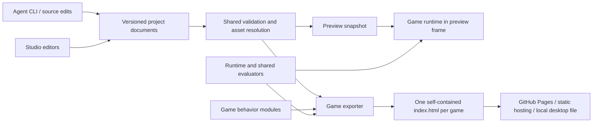

# Plan: a JavaScript studio for self-contained games

**Status:** proposed architecture for review, October 16, 2026. Nothing in this document is an implemented API. Code, commands, and schemas below illustrate the intended contracts.

**Reference:** [Terminator: Liquid Metal](https://mstefanko.github.io/terminator-game/) · [source anatomy](01-game-anatomy.md) · [existing-tools research](03-existing-tools-research.md).

Build a small game runtime, a versioned project format, and a visual authoring studio. Agents and people should create and modify the same project files. The build pipeline should export each game as its own self-contained HTML file. The editor, source files, and framework repository do not need to be one file.

The value is a reliable creative workflow: change a sprite, tune a move, edit a level, compose music, direct a scene, and publish a playable game without repeatedly inventing the plumbing. A generic engine rewrite would delay that workflow.

## 1. Product boundary and first proof

The initial scope is small single-player 2D games: pixel art, modest entity counts, top-down action, arcade arenas, and scrolling encounters. Support both desktop and touch. Keep collision and game rules explicit and reproducible. A platformer or puzzle game should be possible through a game module; do not assume the mall's feet collision and mouse steering fit every genre.

The first proof should be an original mini-game with:

- One playable arena and a short complete title → play → result flow.
- Two interchangeable character skins with different dimensions but compatible animation semantics.
- One shove or shot ability used by a player and an enemy.
- An editable synthesized song and two intensity levels.
- A short cutscene using the same actors, walk animation, and equipment as gameplay.
- A one-file export that behaves like studio preview and works without external networking.

The second proof is a different small game that needs no edits to the framework core. That is the test of reuse. The full Terminator migration is optional and comes later; it should remain a stable reference while the contracts are being proven.

Do not include multiplayer, cloud accounts, collaborative editing, a plugin marketplace, arbitrary shader graphs, full skeletal retargeting, or a general no-code logic language in the first release. These are separate product commitments.

## 2. Runtime decision

**Recommended starting point:** a narrow Canvas 2D runtime, extracting proven ideas and selected code from the current game into modules. Keep one renderer/backend. Evaluate LittleJS with the same vertical slice only if its existing collision, object lifecycle, or input facilities clearly reduce implementation work. Do not maintain two production backends.

| Option | Why consider it | Why it is not the default here |
| --- | --- | --- |
| Small extracted Canvas runtime | Preserves known pixel rendering, score sound, fixed-step behavior, and minimal export; easiest parity investigation | Requires disciplined scope and testing; cannot become an excuse to rebuild every engine facility |
| LittleJS | Compact, fixed-step, procedural audio, touch, lifecycle and collision facilities | Still needs our asset contracts, studio, score model, and exporter; prototype before adopting its assumptions |
| Phaser / Excalibur | Established scene, animation, asset, and game-object facilities | Strong alternatives if the next games need more engine facilities; migration/integration and actual bundle cost must be measured |
| Adopt ct.js / GDevelop | Substantial authoring UI already exists | Faster route if using another product's data model is acceptable; default web exports are not the exact requested single-file workflow |

This is a scoped recommendation, not a benchmark conclusion. Upstream capabilities and export distinctions are documented in the [research comparison](03-existing-tools-research.md). [LittleJS](https://github.com/KilledByAPixel/LittleJS), [Phaser's loader](https://docs.phaser.io/phaser/concepts/loader), and [Excalibur's animation model](https://excaliburjs.com/docs/animation/) provide concrete references.

Keep project data free of Canvas context objects or engine class names. That preserves the possibility of a later migration without building a speculative abstraction over multiple engines today.

## 3. The three products and their dependencies



1. **Runtime:** fixed clocks, scene lifecycle, input actions, assets, sprite animation, rendering, collision primitives, audio playback, timeline playback, saves, and feedback.
2. **Project/tooling:** schemas, migrations, asset import, validation, build, test, inspection, and reusable templates. This is the common interface for agents and editors.
3. **Studio:** a browser authoring application with asset, sprite, level, move, music, cutscene, and flow views. It uses the same renderer, animation evaluator, and audio backend as the exported game.

Suggested source layout:

```text
packages/
  project/          schemas, migrations, validators, document commands
  runtime/          clocks, input, scenes, rendering, collision, audio, timelines
  importers/        palette rows, PNG/atlas, Aseprite; LDtk/Tiled later
  exporter/         resolve, bundle, inline, report, verify
  cli/              agent-facing commands and diagnostics
apps/studio/        editor shell and specialist panels
templates/          minimal-arena, later chase/puzzle/platformer recipes
examples/           original games and contract fixtures
tests/              schema, runtime, exporter, preview parity
```

Use TypeScript for the framework/tooling and allow JS or TS game modules. Use JSON Schema as the public content contract; derive/check implementation types against it so schemas and code cannot drift unnoticed. Ajv is a reasonable validation tool. Use a conventional React/TypeScript studio shell with Vite for development and normal studio distribution. The runtime has no dependency on React. A small esbuild-based exporter is a separate build path. These choices can change during the first slice without changing the content model. [Ajv typing](https://ajv.js.org/guide/typescript.html), [Vite builds](https://vite.dev/guide/build), [esbuild API](https://esbuild.github.io/api/).

## 4. Project format and editing contract

A source project should be a folder, with a ZIP import/export option for the browser studio:

```text
game.project.json
characters/courier.json
sprites/courier-green.sprite.json
sprites/courier-blue.sprite.json
assets/courier-green.png
abilities/shove.ability.json
levels/loading-yard.level.json
music/pursuit.score.json
music/instruments/metal.patch.json
cinematics/arrival.scene.json
flows/main.flow.json
src/game.ts
tests/arrival.scenario.json
```

Use stable IDs such as `character:courier`, not file paths or array offsets, for internal references. The manifest maps IDs to files. Renaming a file does not change identity. Each document declares a schema version; the project pins a runtime version and dependency lock. Keep binary files outside JSON while authoring and inline them only at export.

Separate three kinds of state:

| State | Example | Stored where |
| --- | --- | --- |
| Authored document | Obstacle coordinates, notes, clip names | Project files, diffable and versioned |
| Editor session | Selected object, timeline zoom, open tabs | Local editor preferences/autosave metadata |
| Live simulation | Enemy HP, cooldown, active voices | Runtime instance; discarded on preview restart unless explicitly recorded |

All GUI edits become typed commands such as `MoveEntity`, `ReplaceSpriteBinding`, `SetNote`, or `InsertTimelineClip`. A drag is one undo transaction. The CLI can apply the same commands in a batch. Direct agent edits remain supported: loading a valid JSON edit should not require reproducing the UI's command history. Commands are an editing API, not the only persistence representation.

Use sorted keys/consistent formatting, stable IDs, and predictable file boundaries to keep agent diffs small. Include the expected document revision in command batches to reject stale writes; do not silently overwrite human changes. Avoid real-time multi-user editing until it is required.

Validation has distinct stages:

1. Structural schema: types, units, bounds, version.
2. Reference resolution: all IDs exist and have the right kind.
3. Compatibility: required clips/sockets/actions are supplied.
4. Content semantics: valid spawn areas, score lengths, timeline ownership, reachable flow nodes.
5. Runtime scenarios: movement, hits, outcomes, transitions, and device inputs.

Diagnostics should report file, JSON pointer, code, severity, and repair guidance. For example: `sprites/robot.json /clips/walk: REQUIRED_CLIP_MISSING; character:guard requires locomotion.v1. Provide walk or select an explicit supported fallback.`

Migrations must be explicit and backed up. Do not rewrite all files merely by opening an old project. Unknown major versions fail clearly. Imported project data is declarative; executable game modules are trusted code, never expressions evaluated from arbitrary JSON fields.

## 5. Runtime contracts and execution order

Use plain entity records composed of focused components: transform, body, appearance, animator, health/status, controller, and abilities. Use explicit systems and stable iteration order. A full archetype ECS and event bus for every operation are unnecessary for the expected scale.

The small shared service surface should be explicit:

```ts
// Proposed interface sketch, not an existing package.
interface GameScene {
  enter(ctx: SceneContext, params: unknown): void;
  update(ctx: SceneContext, input: ActionFrame): void;
  render(ctx: RenderContext, view: Readonly<SceneView>): void;
  exit(ctx: SceneContext, reason: "complete" | "skip" | "replace"): void;
}
```

`SceneContext` owns seeded RNG, entities, collision queries, action execution, effects, audio requests, and a disposable resource scope. Every timer, listener, voice group, and transient asset has an owner. Exiting or resetting a scene releases that scope. Rendering can maintain visual caches but must not alter gameplay state or consume gameplay RNG.

Recommended fixed-tick order:

1. Sample semantic input and apply scene transitions/cancellation.
2. Update AI/controllers and request actions.
3. Advance ability phases and resolve authoritative movement/collision.
4. Resolve hits/status effects, then objectives and outcomes with documented priority.
5. Produce presentation events and a render snapshot.
6. Consume edge-triggered input once.

Keep simulation time, presentation time, and audio time distinct. Hit-stop freezes selected simulation systems, not the audio scheduler or all UI. Pausing has an explicit policy for each clock. Separate gameplay RNG from cosmetic/audio RNG so adding sparks cannot change an enemy's next move.

Input should expose `pressed`, `held`, `released`, and `canceled`, plus movement/aim vectors or points. Bind mouse, keyboard, and touch to semantic action IDs. Device labels belong to bindings, not to abilities. Initial templates can use mouse-follow/drag steering; other games can use a virtual stick through a different controller profile. Rotating, losing capture, pausing, and changing scenes must emit cancellation, never an accidental release-to-fire.

Saves use a namespace such as `onepage:<gameId>:<saveVersion>`. GitHub Pages projects can share an origin; repository path alone does not isolate localStorage. Saves need migrations and a blocked-storage fallback. The source project and player saves are different formats.

## 6. Sprite assets, animation, and replacement

This is the most important contract to establish before building a large editor.

### Appearance versus character

A **character archetype** declares gameplay components, body shape, ability IDs, and required presentation capabilities. An **appearance binding** chooses a sprite pack, palette, equipment attachments, and optional portrait pack. Swapping appearance does not change health, AI, movement speed, or collision.

A sprite pack supplies:

- Native frame dimensions, source rectangles, trim offsets, and pixels-per-world-unit.
- Ground/pivot origin and available facings, including permitted mirroring.
- Named semantic clips: `idle`, `walk`, `hurt`, `shove`, `fall`, as required by that character.
- Per-frame durations and sockets such as `hand`, `muzzle`, `head`, and `speech`.
- Optional palette roles, appearance variants, and equipment masks/layer order.
- Capability/rig-profile IDs, asset revision, and source attribution.

Do not require every pack to implement every action. The character declares its requirements; validation checks the binding. Required combat presentation cannot silently disappear. Optional idles may use an explicitly configured fallback. A sprite with no weapon socket is valid for an unarmed character and invalid for a weapon attachment that requires one.

Illustrative sprite fragment:

```json
{
  "schemaVersion": 1,
  "id": "sprite:courier-green",
  "profile": "biped-frames.v1",
  "pixelsPerUnit": 1,
  "origin": [8, 23],
  "facing": {"directions": ["down", "up"], "mirrorX": true},
  "clips": {
    "idle": {"frames": ["front-idle"], "durationsTicks": [12], "loop": true},
    "walk": {"frames": ["front-step-a", "front-step-b"], "durationsTicks": [8, 8], "loop": true}
  },
  "sockets": {"speech": [8, 0], "hand": [13, 15]},
  "revision": 1
}
```

This is a fragment: a complete pack also contains the referenced frame definitions and direction mappings. Coordinates are native image pixels; the renderer converts offsets relative to the origin into world units. Mirroring transforms sockets as well as pixels. Trimmed atlases must preserve the untrimmed coordinate space.

### Three levels of reusable animation

| Level | What transfers | Limits |
| --- | --- | --- |
| Whole-actor motion | Paths, easing, jump arc, recoil offset, shake, squash, fade | Works with any pack with an origin; extreme deformation may look bad in pixel art |
| Semantic frame clips | A character request to `walk`, `hurt`, `shove` | Each skin supplies frames for the same semantic clip; frame counts can differ |
| Segmented rig animation | Limb rotations/poses on named bones/parts | Requires compatible topology, pivots, constraints, and art; later extension |

The promise is reusable movement and semantic actions, not automatic animation of any PNG. Whole-body motion should be directly evaluable at a time. Semantic clips translate normalized action phase to the skin's frames. Combat uses authoritative tick windows; cosmetic clip changes cannot move damage timing. If content intentionally changes action timing, edit the ability definition as a separate gameplay change.

Gameplay movement owns root position. Recoil and bob are visual offsets by default. A dash ability moves the collision body and requests an animation; the sprite animation does not secretly move the body. During a cutscene, a timeline can explicitly take ownership of root motion.

### Sprite editor workflow

Start with import and assembly: PNG sheets, Aseprite JSON, and the current palette-row representation. Let the user mark origin/sockets, map tags to semantic clips, adjust duration, preview facing, assign palettes/equipment, and replace a skin live in an animation test scene. Add a simple indexed pixel grid with onion skin after import/replacement works; a full Aseprite competitor is unnecessary. Aseprite already exports tags/slices/pivots useful to this importer. [Aseprite CLI](https://www.aseprite.org/docs/cli/), [slices](https://aseprite.com/docs/slices/).

The replacement preview should show idle/walk/hurt/attack, attachments, foot contact, cutscene playback, and unchanged collision outlines. Cache by asset ID, content revision, palette, equipment, facing, and frame. Editing a body must invalidate its baked art.

## 7. Moves, AI, collision, and feedback

An ability is a registered behavior implementation plus typed configuration. Use a small set of implementations such as shove, projectile, timed protection, dash, and interact. Complex boss behavior can remain a custom TS/JS module. Avoid building a universal visual scripting language first.

Proposed ability data:

```json
{
  "schemaVersion": 1,
  "id": "ability:shove",
  "implementation": "core.shove.v1",
  "input": "secondary",
  "timingTicks": {"startup": 6, "active": 1, "recovery": 8, "cooldown": 90},
  "targeting": {"shape": "arc", "range": 28, "halfAngleRadians": 1.25, "requiresLineOfSight": true},
  "effects": {"pushDistance": 22, "stunTicks": 18},
  "presentation": {"clip": "shove", "sound": "sfx:shove", "onHit": "feedback:shove-hit"}
}
```

The implementation defines activation guards, faction/target filters, interruption, cooldown start policy, collision sweep, and deterministic hit ordering. Do not hide those semantics in a generic `effects` dictionary without a validating implementation schema. Validate configuration against the exact implementation version.

The lifecycle is ready → startup → active → recovery → ready, with a separate cooldown timer and explicit interrupt rules. Cooldown may overlap recovery; define it once in the implementation. Charges are spent only after successful activation. Each execution gets an ID so a persistent hit shape cannot damage the same target repeatedly unless the move allows it.

Player and AI controllers call the same `requestAction(actorId, actionId, target)` API. AI tuning can choose a different configured variant, but it must not bypass damage or protection rules. A shared hit resolver reads damage categories and status tags: enemy projectile, contact grab, environmental fire, scripted penalty. This directly prevents the box-protection inconsistencies seen in the reference game.

Presentation listens to typed outcomes such as `ability.started`, `hit.blocked`, `hit.applied`, `pickup.collected`, and `objective.completed`. Sound, flash, shake, hit-stop, and floating text are feedback recipes. Do not let particles or sound determine whether a hit happened.

The move inspector should show startup/active/recovery/cooldown, hit shapes, target filters, resources, interruption rules, and feedback in a small test arena. It should report why an attempted move failed. This is more useful than an animation preview that makes a shove look successful when its target query missed.

## 8. Level and encounter authoring

Use separate definitions and instances, following the useful patterns in [LDtk](https://ldtk.io/docs/game-dev/json-overview/) and [Tiled templates](https://doc.mapeditor.org/en/stable/manual/using-templates/).

A level document contains viewport/world size, layers, background/tiles, solids, spawn points, actor instances, paths/waypoints, trigger regions, objectives, music cue, and encounter-module configuration. Collision geometry is independent of decoration. Instance overrides are typed and limited to declared fields.

The first level editor needs placement, selection, grid snap, multi-select, a hierarchy/layer list, collision rectangles/polygons, paths, typed inspector, spawn validation, and a Play Here button. Show playable bounds and HUD-safe areas. Preserve IDs when moving content; allocate fresh IDs when duplicating, remapping references within the duplicated selection while retaining references to shared assets. Add LDtk/Tiled import adapters once the canonical shape is stable; preserve source references and warn about unsupported features rather than silently dropping them.

Model repeating hazards and spawns as authored parameters/patterns, not one object per future tick. A chase module can read spawn lanes, wave patterns, telegraph lengths, obstacle pools, distance milestones, and boss phases. The encounter module still owns pursuit and victory logic. The editor gives it a schema-driven inspector plus an encounter-specific preview where needed.

Editor state must remain separate from Play mode. Restart creates a fresh runtime from an immutable snapshot. Moving an enemy during play is a debug operation unless the user explicitly applies that transform back to the level document.

## 9. Music and SFX construction interface

Start by extracting the current Web Audio instruments and scheduler, replacing hardcoded track builders with a canonical score model. Keep the recognizable distinction between cinematic and gameplay arrangements: shared motif and instrument family, different rhythm, articulation, density, and intensity. Merely increasing BPM should be one option, not the entire composing workflow.

### Data and clocks

Use **integer musical ticks at 480 ticks per quarter note** for authored note/automation positions. This exactly represents the current quarter/eighth/sixteenth subdivisions and common triplets. Store tempo in BPM, note pitch as MIDI number, duration in musical ticks, velocity in a documented normalized range, and pan in −1…1. A meter map controls bar display; it must support six-beat and 6.5-beat phrases. Musical ticks are never simulation ticks.

A score has instrument references, reusable patterns, arrangement lanes with pattern instances, loop markers, tempo/meter, automation, and cue/transition metadata. Keep the initial release to one tempo per cue, with a documented future tempo-map extension. Do not implement tempo-map UI before timing inversion and transport seeking have tests.

The production scheduler converts musical positions to `AudioContext` seconds and schedules ahead. Game state requests cues/intensity; it does not drive individual notes on animation frames. Intensity changes can apply at phrase/bar boundaries. Define stop, pause/resume, seek, crossfade, and voice cleanup explicitly. A sound played during export preview must use the same preset and backend as in the game.

### Editor layout and workflow

| View | User action | Shared output |
| --- | --- | --- |
| Drum/step sequencer | Toggle machine pulses, accents, fills | Percussion events in patterns |
| Piano roll | Add/resize notes, set velocity, transpose | Pitched events in patterns |
| Instrument inspector | Adjust oscillator mix, attack/release, filter, noise, room | Versioned synth patch |
| Arrangement lanes | Repeat patterns, add intro, loop a reading bed | Pattern instances and loop range |
| Cue/intensity view | Compare title, exploration, combat, boss; audition danger levels | Cue routing and layer conditions |
| SFX designer | Shape a sweep, noise burst, multi-hit sequence | Short effect recipe |

Use transport play/stop/loop, mute/solo, a beat ruler, and an intensity slider. Keep initial patch vocabulary small: the reference game's brass, strings, bass, pulse, glass, threat, metal, drum, and snare are enough for a compelling first interface. Presets should be generic original sounds; film-specific melodies/content belong in game projects, not framework defaults.

Use `OfflineAudioContext` rendering for audition exports and regression analysis where supported, plus actual listening checks. Compare note timing, peak levels, silence, and voice disposal rather than demanding identical audio bytes across browsers. Define polyphony and node limits; report clipping. Audio-unlock and suspended-context recovery are required on phones.

[Tone.js](https://github.com/Tonejs/Tone.js) is a strong alternative when advanced transport/effects justify its measured cost. Do not preview with Tone and export with a different synth unless the supported equivalence is formally defined and tested. One shared backend is the simpler first choice.

## 10. Cutscene director using real game assets

The director edits a shot list plus timelines. A shot has actor bindings, camera, background/level reference, duration, and tracks. A binding uses `character:courier` or a stable level entity ID; replacing that character's skin changes gameplay and cutscene staging together. Optional portrait art remains a separate presentation resource for close-ups.

Tracks should support position/path, facing, semantic animation clip, visual offset/scale/opacity, attachment, camera framing, dialogue, sound cue, music cue/intensity, and named effects. Reuse movement clips such as enter-left, walk-to-marker, hop, recoil, stagger, turn, and fall. Expose path control points and phase timing in the inspector. Do not encode “T-800 arm pixels” in a reusable motion asset.

Illustrative binding:

```json
{
  "schemaVersion": 1,
  "id": "cinematic:arrival",
  "durationTicks": 180,
  "actors": {"hero": {"character": "character:courier", "start": [20, 120]}},
  "tracks": [
    {"actor": "hero", "property": "position", "keys": [{"tick": 0, "value": [20, 120]}, {"tick": 120, "value": [120, 120]}]},
    {"actor": "hero", "property": "clip", "keys": [{"tick": 0, "value": "walk"}, {"tick": 120, "value": "idle"}]}
  ],
  "onComplete": "flow:arrival-complete",
  "onSkip": "flow:arrival-complete"
}
```

Here cinematic ticks use the configured 60 Hz timeline rate. A future beat-locked track references a score position through an explicit conversion; do not silently equate timeline ticks with musical ticks.

### Scrubbing and ownership rules

- `evaluate(scene, time, bindings)` computes visual state from authored initial state and tracks. Scrubbing to a frame is independent of previously visited frames.
- Forward playback emits discrete sound/effect events through a separate cursor. Seeking is silent by default and does not emit gameplay events.
- The timeline takes an explicit lease on controlled actor properties. AI/input stop writing those properties until the lease ends. Validate conflicting tracks instead of relying on last-writer order.
- On completion, skip, or cancellation, dispose voices/effects and restore or commit actor state according to the scene's declared policy.
- Completion/skip emits one declared outcome. Skipping does not replay all missed callbacks to reach the final state.
- Use presentation-only actor proxies by default for standalone scenes. In-world cinematics may bind live entities with explicit ownership and restoration. A scripted weapon animation does not damage real actors unless a separately authored gameplay command intentionally does so.

The director view should have a scene preview using the runtime renderer, shot thumbnails, actor tracks, property lanes, keyframe/easing inspector, dialogue panel, transport, markers, and frame stepping. Dragging a character at the current time creates a keyframe only in record/keyframe mode. Otherwise it edits the shot's initial pose. Distinguish those modes visibly.

Borrow the editor/runtime separation from [Theatre.js](https://www.theatrejs.com/docs/latest/api/core), but do not assume its entire editor has its core license: core and Studio have different upstream licenses. The first director can be purpose-built around the smaller track vocabulary.

## 11. Menus, flow, and studio shell

Use a named flow graph for title, selection, cutscene, level, result, upgrade, and ending states. Nodes reference scene/level IDs; edges consume typed outcomes such as win, lose, continue, skip. Validate missing targets and unintended unreachable nodes. Avoid callbacks stored inside JSON.

Runtime menu templates use a lightweight layout/hit-test model with safe regions and shared action metadata. Provide title, selection, briefing, pause/help, result, and settings templates first. Draw pixel-styled game UI on canvas where desired; offer semantic DOM controls for focus, accessibility, and touch actions. The studio itself uses ordinary DOM UI. Readable controls and captions should not depend on enlarging tiny gameplay pixels.

The studio shell has a project browser, central preview/editor, inspector, and validation panel. Sprite, level, music, cutscene, and flow views share selection conventions, undo/redo, asset IDs, and a Play/Stop action. Use JSON Schema-generated inspectors for ordinary fields; specialist editors handle images, notes, geometry, and timelines.

Preview runs a production runtime in a separate frame with a versioned message protocol. It receives a project snapshot and emits logs, action traces, selection hits, and runtime errors. Treat frame isolation as containment, not a complete sandbox for arbitrary hostile code. Explicitly trusted game modules run in preview; data-only projects need no executable snippets. Validate message origin/session token and restart cleanly when the project revision changes.

Local-first storage: open/import a project ZIP, edit, autosave to IndexedDB, and export a project ZIP or game HTML. Use filesystem access where supported as an enhancement, with browser-compatible import/download as the baseline. Autosave must show recovery status and not masquerade as a durable external backup. Cloud sync can follow later.

## 12. Agent workflow and tooling

Give agents a small documented command surface with machine-readable results. Proposed examples:

```text
gamekit create courier-demo --template arena
gamekit inspect courier-demo --json
gamekit validate courier-demo --json
gamekit assets check courier-demo --character character:courier
gamekit preview courier-demo --level level:loading-yard --seed 42
gamekit test courier-demo --scenario tests/arrival.scenario.json
gamekit build courier-demo --format single-html --out dist/index.html
gamekit verify dist/index.html --offline
```

Provide one canonical small example per asset kind and one complete example game. Every game template needs a contract describing simulation units, input profiles, scene lifecycle, public action APIs, and test entry points. Include a `GAME_SPEC.md` with the core loop, controls, goals, art direction, musical identity, and acceptance scenarios. An agent should be able to inspect a project without parsing an embedded PNG or searching 11,000 lines of HTML.

Support data-only tasks without editing runtime code: add a skin, replace an instrument, rearrange notes, move obstacles, place enemies, retime a shot. A new mechanic may add a registered behavior module, its configuration schema, and tests. Promote it into the shared runtime only after another game actually needs it.

A generated HTML file is an output, not the source agents should normally patch. Keep project source and build revision in a separate source archive/repository. Optional source-in-HTML export can be added later, inspired by [Bitsy's importable HTML](https://make.bitsy.org/docs/zh-Hans/tools/game/save/index.html); do not double every game's payload by default.

## 13. Single-HTML compiler and publication

The exporter should:

1. Validate versions, documents, references, sprite compatibility, and registered behaviors.
2. Resolve the reachable content graph from the entry flow, plus explicitly declared runtime-selected assets. Dynamic string IDs need a declared dependency list; otherwise pruning can remove needed content.
3. Compile source modules into a browser bundle with no unresolved imports or chunks. For the initial target, an inline IIFE keeps direct-file loading straightforward.
4. Compile palette rows/atlases and synth/score data into runtime forms. Inline PNGs and any supported sample audio. Decode required assets before play, with progress/error UI.
5. Inline CSS, runtime JS, project data, and required license notices into one HTML document. Escape HTML/script terminators in data and source safely. Avoid `eval` of project strings.
6. Emit a build report containing versions, source hash, reachable assets, raw/compressed byte counts, decoded image memory estimates, audio limits, and notices. The report is a development artifact; the playable deliverable remains one file.
7. Test that artifact with networking blocked and at a nested static-host path. Verify no external scripts, fonts, media, CSS URLs, source-map dependencies, dynamic imports, or worker files are required.

[esbuild](https://esbuild.github.io/api/) provides bundling, IIFE output, data-URL loaders, metadata, and inline legal notices; it does not by itself prove the HTML is self-contained. Vite's studio build is a separate multi-file application. The exporter must fail clearly if a selected feature cannot meet the one-file target.

Use reproducible asset ordering and pinned dependencies. Keep timestamps out of the deterministic payload or place them only in the report. Base64 has a size cost; prefer compact generated data for pixels/music where it makes sense, but do not sacrifice character likeness to avoid modest embedded images. Establish warning budgets from measured examples; a reasonable initial review target is a few MB, not an unsupported guarantee about all future games.

Each game can live in its own personal repository with `dist/index.html` published to GitHub Pages, or as a subfolder on a static host. Neither approach requires a backend. A separate source project can be stored in the same repo without making it a runtime dependency. HTTPS is the main mobile sharing route; one HTML file does not guarantee every phone's file manager will launch it correctly.

Framework code, third-party code, and game assets have separate licenses/attribution. Keep a manifest of dependencies and asset provenance. Do not place the Terminator characters or score in generic framework starter content; use original examples while retaining the reference game as a separate project.

## 14. Implementation sequence and acceptance gates

Each phase ends with a runnable artifact and an inspectable diff. These are dependency-ordered milestones, not calendar estimates.

| Phase | Deliverable | Acceptance gate |
| --- | --- | --- |
| 0 — Baseline and contracts | Pinned reference, fixture captures, project manifest, coordinate/time conventions, schema skeleton | Existing game untouched; source inventory and current input tests reproducible; no new engine chosen solely from marketing |
| 1 — End-to-end CLI slice | Minimal Canvas runtime, actions, scene lifecycle, sprite pack, one ability, one score, one cutscene, single-HTML exporter | Original micro-game plays on desktop/touch; built artifact has zero required network requests; two skins swap without rule changes |
| 2 — Studio shell and assets | Project import/save, commands/undo, asset browser, sprite clip/socket editor, runtime preview | Human edits and agent edits round-trip; replacement updates both game and scene; invalid pack produces useful diagnostics |
| 3 — Level and move tools | Placement/collision/path editor, ability inspector/test arena, action-derived controls | A new arena is authored without code; AI/player action parity and collision-safe shove verified; bad spawns caught |
| 4 — Music workbench | Sequencer, piano roll, patch inspector, arrangements, intensity audition, cue routing | Edit a rhythm/timbre and hear the same result in preview/export; no stuck voices after repeated stop/seek; transition timing verified |
| 5 — Cutscene director and flow | Actor bindings, timeline/keyframes, reusable motion library, dialogue, camera, scene flow | Skin change propagates; arbitrary seek is stable; skip/completion emit one outcome; live actor control restored |
| 6 — Reuse proof and hardening | A second original game, template guide, build reports, browser matrix, packaging tests | Second game uses the same core unchanged; agent can implement from documents; portrait/landscape and desktop regression pass |
| 7 — Optional Terminator migration | Incremental adapters/extraction with parity fixtures | Move one layer at a time; differences explained and approved as intentional; no wholesale rewrite required |

The CLI slice in phase 1 includes minimal handwritten score and cutscene data before their full visual editors. This avoids discovering incompatible schemas only after several editors exist. The studio shell can show all planned tool tabs, but unfinished tabs should not imply working capability.

### Migration seams in the reference game

| Current implementation | First reusable form | Keep game-specific |
| --- | --- | --- |
| `BASE`, `OV`, `CAST`, sprite caches | Palette-row importer and sprite-pack renderer | Character art, gear layouts, portrait payloads |
| `INPUT` + touch adapter | Semantic action profiles and cancellation tests | Per-role bindings and descriptions |
| `frame`, `stepOnce`, scene dispatch | Clocks, scene lifecycle, deterministic stepping | Campaign graph and encounter policies |
| `SCORE_VOICES`, score events, scheduler | Synth backend and score documents | Musical composition and cue choices |
| `CUT_SCENES`, `ciShot` | Storyboard import plus reusable tracks incrementally | Bespoke close-ups until explicitly converted |
| `SOLIDS`, doors, themes, spawns | Level content/schema | Mall/ward layouts and chase/mill encounter code |
| Shove, protection, projectiles, pickups | Action/hit/feedback contracts proven by small examples | Film-specific ability variants and balance |

Do not lift all of `G`, `DR`, or `BS` into a framework singleton. Use an adapter around an encounter while extracting its dependencies gradually. Old and new builds can coexist until parity is established.

## 15. Verification and risks

Keep the following release gates in the repository, not only temporary local scripts:

- **Deterministic scenarios:** fixed seed, tick-stamped semantic inputs, stable entity IDs, and expected outcomes. Deterministic means within the defined runtime/version/math model; do not promise cross-browser bitwise physics without measuring it.
- **Sprite swap invariants:** same body/collision, same ability hit ticks, correct sockets and ground contact, distinct skins in gameplay and cutscenes, cache invalidation after edits.
- **Input matrix:** mouse/keyboard, rapid taps, two fingers, lost capture, canceled holds, pause/resume, orientation, and hybrid devices. Compare desktop behavior before/after any touch change.
- **Ability rules:** startup interruption, hit-once, cooldown/charge policy, wall blocking, friendly targets, invulnerability categories, and simultaneous victory/death priority.
- **Timeline behavior:** direct seek equals sequential evaluation visually; backward scrubs do not emit SFX/rewards; skip and completion are idempotent; all property leases released.
- **Audio:** event-time correctness, loops, intensity boundaries, clipping/headroom, resumed contexts, source cleanup, and human listening. Do not rely on a mocked audio graph alone.
- **Artifact parity:** editor and export share runtime versions; screenshots at fixed states, gameplay traces, no external requests, direct desktop file load, HTTPS mobile load, nested host paths, and blocked-storage behavior.
- **Project integrity:** migrations, undo/redo, import/export round-trip, schema rejection, stale edit detection, source path normalization, and recovery from interrupted saves.

Main risks are overgeneralization, art contracts that promise impossible retargeting, editor/export drift, clock confusion, large embedded payloads, and lost source/editability. The architecture addresses them with a small first genre scope, explicit sprite capabilities, shared evaluators, typed time units, build reports, and a separate editable project format.

## 16. Decisions for review

Recommended defaults are ready to implement if accepted:

| Decision | Recommendation | What would change the decision |
| --- | --- | --- |
| First target | Original top-down arena micro-game | A specific next game with a different core mechanic |
| Runtime | Small Canvas runtime with selected extraction; one backend | Prototype shows LittleJS/Phaser/Excalibur materially reduces work |
| Editable source | Folder/ZIP of JSON assets plus JS/TS behavior | A hard requirement to edit the published HTML itself |
| Sprite scope | Semantic frame clips, sockets, palettes, reusable whole-body motion | Two real games need compatible segmented rigs |
| Music | Shared compact Web Audio backend and original presets | Advanced composition requirements justify Tone.js integration |
| Studio | Browser-first, local-first React/TS app | Required desktop file workflows cannot be handled by import/export |
| Editor order | Sprite → level/moves → music → cutscene/flow, after CLI slice | Music creation is the immediate highest-value standalone tool |
| Publication | One HTML per game, personal static hosting | User explicitly permits a multi-file release for oversized games |
| Terminator | Keep working release stable; migrate later by layer | Maintaining two implementations becomes more expensive than measured migration |

The immediate next implementation task is phase 0–1: prove a complete small game, sprite interchange, score playback, cutscene binding, and one-file export through documented contracts. That produces something useful to build on before committing to a large editor.
