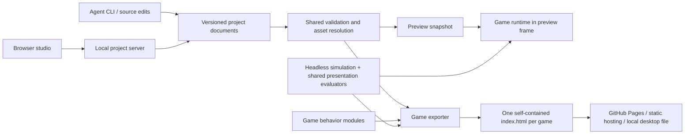

# Architecture and implementation plan: a studio for one-file games

**Status:** consolidated proposal for review, October 16, 2026. Nothing in this document is an implemented framework API. Code, commands, document fields, targets, and tests below specify intended contracts. Section 17 separately describes the inspected reference game, not future functionality.

**Reference:** [Terminator: Liquid Metal](https://mstefanko.github.io/terminator-game/) · [consolidated research and evidence](01-research.md) · [source anatomy in this document](#17-reference-game-anatomy).

Read sections 1–5 for the system boundary and source/runtime contracts, 6–11 for each creative layer, 12–15 for delivery and implementation, and 17 for the concrete game walkthrough. The research document records source-backed choices and corrections; this document is the framework-wide implementation baseline.

**October 16 follow-on:** [Repository and asset strategy](03-repository-and-asset-strategy.md) specializes the package boundaries and adds a personal cross-tool library. The [composer plan](04-chiptune-composer-plan.md) prioritizes a standalone composer track that can precede the full game studio. Those documents govern the new tool/library work; the headless runtime, renderer experiment and one-file game acceptance gates below remain intact. The repo now has documentation and private workspace scaffolding, but none of the runtime/editor APIs below are implemented.

Build a small game runtime, a versioned project format, and a visual authoring studio. Agents and people should create and modify the same project files. The build pipeline should export each game as its own self-contained HTML file. The editor, source files, and framework repository do not need to be one file.

The value is a reliable creative workflow: change a sprite, tune a move, edit a level, compose music, direct a scene, and publish a playable game without repeatedly inventing the plumbing. A generic engine rewrite would delay that workflow.

## 1. Product boundary and first proof

The initial scope is small single-player 2D games: pixel art, modest entity counts, top-down action, arcade arenas, and scrolling encounters. Support both desktop and touch. Keep collision and game rules explicit and reproducible. A platformer or puzzle game should be possible through a game module; do not assume the mall's feet collision and mouse steering fit every genre.

The first proof should be an original mini-game with:

- One playable arena and a short complete title → play → result flow.
- Two interchangeable character skins with different dimensions but compatible animation semantics.
- One shove or shot ability used by a player and an enemy.
- An editable synthesized song and two intensity levels.
- A short cutscene using the same actors, walk animation, and equipment as gameplay.
- A one-file export that behaves like studio preview and works without external networking.

The second proof is a different small game that needs no edits to the framework core. That is the test of reuse. The full Terminator migration is optional and comes later; it should remain a stable reference while the contracts are being proven.

Do not include multiplayer, cloud accounts, collaborative editing, a plugin marketplace, arbitrary shader graphs, full skeletal retargeting, or a general no-code logic language in the first release. These are separate product commitments.

## 2. Runtime decision

**Provisional baseline:** a narrow Canvas 2D renderer and pure simulation core, extracting ideas and selected code from the reference. Before committing, compare this with a LittleJS integration using the same content and acceptance scenarios. Keep one production backend after the decision. “Custom” is not an invitation to rebuild general-purpose engine facilities.

| Option | Useful fit | Decision boundary |
| --- | --- | --- |
| Small Canvas implementation | Familiar pixel rendering, explicit simulation/data ownership, minimal delivery path | Must prove reasonable maintenance cost, not merely a small demo |
| LittleJS | Existing rendering, input, audio, collision, lifecycle and editor facilities | Must fit our content contracts and headless simulation without an enduring fork; investigate reuse of its editor facilities too |
| Phaser / Excalibur | Broader scene, graphics, asset and game-object facilities | Reconsider if both initial candidates fail or the next games require substantially more engine services |
| ct.js / GDevelop | Existing game-authoring products | Alternative product strategy if accepting their workflows/data models is preferable to building our studio |

Upstream facts and links are in [the research](01-research.md). Project data must not contain engine classes or Canvas contexts. Implement the selected backend directly behind the few services the project actually needs, not a speculative multi-engine abstraction.

### Required Canvas versus LittleJS experiment

Build two disposable hosts around one immutable fixture. This experiment implements only tiny fixture versions of the later gameplay/audio/timeline features; milestones 1c–1d generalize and harden them after selection. It does not depend on completing those milestones first. Fixture: a 256 × 176 arena, 40 actors, 20 moving projectiles, static walls, one shove, two skins, a short scene, and a small synthesized cue. Include 100-actor/100-projectile stress mode. Share the same project JSON, action recordings, renderer-independent rules, and deterministic math helpers. Record exact upstream commits, browser/device versions and build settings.

**Hard gates for either candidate:**

1. Import and step the authoritative simulation in Node with no DOM, Canvas, AudioContext, or browser mocks. A browser engine may host rendering/input, but its scene loop must not be required by simulation.
2. Run a 10,000-tick scenario in Node and Chromium/Firefox/WebKit, including snapshot/restore, and match canonical state hashes at checkpoints. Rendering FPS must not affect outcomes.
3. Pass skin/socket, desktop/touch cancellation, clean scene teardown, direct-time cutscene seek, and no-network single-HTML tests. Do not put collision timing inside an engine's variable frame callbacks.
4. Meet the asset/document boundary without changing public documents to vendor object types. Document any engine functionality disabled to meet these rules; subtract its supposed reuse benefit.
5. Require no upstream source fork, proprietary key, or second copy of the score/timeline logic. A small documented adapter is acceptable.

**Measure, do not assume:** raw/gzip exported bytes split by runtime/content/recovery data; cold start until input-ready; p50/p95 frame and simulation-step time; memory after 20 scene restarts; adapter code and the concrete facilities each candidate lets us delete. Use five repeat runs on the same desktop and one named midrange phone. Proposed first-slice gates are runtime JS ≤250 KiB gzip excluding content, total tiny-demo HTML ≤2 MiB raw, input-ready within 2 seconds on the recorded phone, and p95 update + draw ≤12 ms for the normal workload. These are chosen budgets, not measured claims; record exceptions before expanding scope.

Choose LittleJS if it passes all hard gates/budgets and demonstrably removes maintenance of at least two needed facilities (for example rendering/atlas handling and input/scene hosting) without replacing that saving with equivalent adapter code. Choose the narrow implementation if both pass and LittleJS provides no such saving. If neither passes, revisit the scope or compare a larger engine; do not quietly waive determinism or headless operation. Save the scorecard, traces, artifact hashes, and rationale as the implementation decision record. Remove the losing prototype from supported runtime paths.

## 3. The three products and their dependencies



1. **Runtime:** fixed clocks, scene lifecycle, input actions, assets, sprite animation, rendering, collision primitives, audio playback, timeline playback, saves, and feedback.
2. **Project/tooling:** schemas, migrations, asset import, validation, build, test, inspection, and reusable templates. This is the common interface for agents and editors.
3. **Studio:** a browser authoring application with asset, sprite, level, move, music, cutscene, and flow views. It uses the same renderer, animation evaluator, and audio backend as the exported game.

Suggested source layout:

```text
packages/
  project/          TypeBox schemas, migrations, validation, commands
  simulation/       DOM-free rules, fixed-point math, snapshots, replays
  runtime/          browser host, input adapters, rendering, audio, timelines
  studio-server/    project-folder API, atomic transactions, file watching
  importers/        palette rows, PNG/atlas, Aseprite; LDtk/Tiled later
  exporter/         resolve, bundle, inline, report, verify
  cli/              agent-facing commands and diagnostics
apps/studio/        editor shell and specialist panels
templates/          minimal-arena, later chase/puzzle/platformer recipes
examples/           original games and contract fixtures
tests/              schema, runtime, exporter, preview parity
```

Use TypeScript for framework/tooling and allow registered JS/TS game modules. **TypeBox is the schema/type authority:** generate public JSON Schema and infer TS types from its definitions. Use Ajv for CLI/server/studio validation; do not ship the full authoring validator with every game. Small save/recovery boundary validators may be compiled separately. Hand-written migrations own semantic version changes. TypeBox’s actual MIT text was checked; see [research](01-research.md).

Use React/TypeScript with Vite for the studio. React, undo, file services, inspectors, and test tools stay outside exported games. Keep an esbuild + HTML exporter separate from the studio build. `simulation` cannot import browser runtime or editor packages; enforce that dependency rule in CI. CLI and server call project services directly; the studio uses their versioned local API. A hosted demo uses an alternate storage adapter with the same document commands.

## 4. Project format and editing contract

The primary source is a project folder edited by both agents and `gamekit studio <folder>`. ZIP is a portable source backup/import format; browser-private storage is the hosted-demo fallback:

```text
game.project.json
characters/courier.json
sprites/courier-green.sprite.json
sprites/courier-blue.sprite.json
assets/courier-green.png
abilities/shove.ability.json
levels/loading-yard.level.json
music/pursuit.score.json
music/instruments/metal.patch.json
sfx/impact.sfx.json
feedback/shove-hit.feedback.json
tuning/normal.tuning.json
upgrades/boots.upgrade.json
fonts/pixel.font.json
cameras/arena.camera.json
cinematics/arrival.scene.json
flows/main.flow.json
src/game.ts
tests/arrival.scenario.json
```

Use stable IDs such as `character:courier`, not file paths or array offsets, for internal references. The project also has a globally distinct `gameId`; creating a new game from a template or cloning as a new game allocates a new ID, while rebuilding an existing game preserves it. The manifest maps IDs to files. Renaming a file does not change identity. Each document declares a schema version; the project pins a runtime version and dependency lock. Keep binary files outside JSON while authoring and inline them only at export.

Separate three kinds of state:

| State | Example | Stored where |
| --- | --- | --- |
| Authored document | Obstacle coordinates, notes, clip names | Project files, diffable and versioned |
| Editor session | Selected object, timeline zoom, open tabs | Local editor preferences/autosave metadata |
| Live simulation | Enemy HP, cooldown, active voices | Runtime instance; discarded on preview restart unless explicitly recorded |

All GUI edits become typed commands such as `MoveEntity`, `ReplaceSpriteBinding`, `SetNote`, or `InsertTimelineClip`. A drag is one undo transaction. Implement local history using Immer forward/inverse patches with `enablePatches()`, linked to document revisions. Keep Immer’s array-path representation internal, or explicitly convert it for a JSON Patch API. The CLI can apply the same semantic commands in a batch. Direct agent edits remain supported: loading a valid JSON edit should not require reproducing the UI's command history. Commands are an editing API, not the only persistence representation.

Use sorted keys/consistent formatting, stable IDs, and predictable file boundaries to keep agent diffs small. Include the expected document revision in command batches to reject stale writes; do not silently overwrite human changes. On external changes, validate and reload a clean document; if local edits conflict, retain both revisions and require conflict resolution before writing. Never apply inverse patches to a different base. Clear affected history on external reload in v1; rebasing is deferred. Avoid real-time multi-user editing until it is required.

Validation has distinct stages:

1. Structural schema: types, units, bounds, version.
2. Reference resolution: all IDs exist and have the right kind.
3. Compatibility: required clips/sockets/actions are supplied.
4. Content semantics: valid spawn areas, score lengths, timeline ownership, reachable flow nodes.
5. Runtime scenarios: movement, hits, outcomes, transitions, and device inputs.

Diagnostics should report file, JSON pointer, code, severity, and repair guidance. For example: `sprites/robot.json /clips/walk: REQUIRED_CLIP_MISSING; character:guard requires locomotion.v1. Provide walk or select an explicit supported fallback.`

Migrations are hand-written pure `vN → vN+1` functions with old/new fixture pairs. Validate before and after each step, preserve IDs, produce a report, and offer dry-run plus an automatic source backup before committing the migration. Project and individual document versions are separate. Migrations must be explicit and backed up. Do not rewrite all files merely by opening an old project. Unknown major versions fail clearly. Imported project data is declarative; executable game modules are trusted code, never expressions evaluated from arbitrary JSON fields.

### Document catalog: no hidden content layer

Every document has `schemaVersion`, a stable `id`, and typed references. Units below are explicit schema fields or fixed by the kind; JSON must not contain executable expressions. Manifest entries include kind, relative file path, content hash and optional provenance. Unknown fields are rejected unless a named extension schema permits them.

| Kind | Required content contract | Consumer and validation |
| --- | --- | --- |
| Project | `gameId`, schema/runtime versions, entry flow, document/asset registry, behavior registry, dependency lock | Loader/compiler; unique IDs, contained paths, complete references |
| Character | Body dimensions, controller/ability IDs, health/status defaults, appearance requirements | Simulation + binding resolver; compatible clips/sockets, positive dimensions |
| Sprite | Frames, per-frame sockets/origin, facings, semantic clips, palette/material and attachment metadata | Renderer/editor; valid rectangles, frame durations, complete required sockets |
| Ability | Implementation/version, action, timing, targeting, resources, outcomes and presentation bindings | Simulation; implementation-specific schema, legal phase/cancel policies |
| Level | Bounds/layers, collision, instances, spawn/trigger/path IDs, encounter/config, music/camera | Level loader; valid spawns, geometry, IDs and encounter config |
| Score | PPQ, BPM, patterns/events, phrase/arrangement lengths, loop, cue/intensity routing | Audio transport; integer representable times, valid notes, finite loops/voice bounds |
| Synth patch | Backend/version, oscillators/noise/filter/envelope, gain and sends | Music synth; parameter ranges and safe voice limits |
| SFX | `backend: zzfx`, `backendVersion`, named recipe params, `seed`, gain, max voices, retrigger policy | SFX adapter; bounds and recipe-version conversion; no anonymous numeric-array contract |
| Feedback | Named event binding, SFX ID, particles/flash/visual shake/floating text, lifetime and accessibility intensity | Presentation; bounded duration/count, cosmetic RNG, no health/objective writes |
| Tuning | Named profile, typed values with units/min/max, declared consumer keys, hot-reload policy | Compiler/simulation; no arbitrary path writes, unknown keys fail, affects gameplay hash |
| Upgrade | Cost/currency, max rank, prerequisites/exclusions, typed stat modifiers or ability grants, presentation ID | Progression rules; deterministic modifier order, no prerequisite cycles, legal caps |
| Font | Bitmap asset + glyph rectangles/advances/baseline/fallback, or embedded font asset + family/metrics policy | UI/text; required caption glyph coverage, no remote font URL; embed notices |
| Camera | Mode, bounds/dead zone, target binding, offset/zoom limits, transition and shake policy | Presentation; finite values, safe viewport, defined ownership and override priority |
| Cinematic / motion | Actor bindings, duration, property tracks/keys, events, reusable whole-body motions, completion policy | Shared timeline evaluator; conflicting ownership and invalid targets rejected |
| Flow / menu | Nodes, typed outcomes/edges, menu template/action metadata, text/font/style references | Flow host + UI; entry exists, valid edges, reachable required states |
| Scenario / replay | Seed, versions/content hash, tick-stamped semantic input, checkpoints and assertions | Headless runner; reproducible state hashes and explicit incompatibility diagnostics |
| Player save | `gameId`, save schema version, progression snapshot, checksum/version metadata | Save service; bounded/validated payload, migration and fallback |

Feedback recipes are presentation-only. If hit-stop changes authoritative simulation progression, its duration comes from an ability/rules field and enters replay state; a cosmetic feedback edit cannot alter it. Camera motion may ease in presentation, but the input adapter must resolve pointer coordinates into quantized world targets before recording an action frame. Gameplay boundaries never depend on a cosmetically shaken viewport.

Tuning example: `enemy.fireCooldownTicks` is an integer duration with minimum 1, a declared encounter consumer, and `nextActivation` application policy. Upgrade modifiers use a documented order (base → additive → fixed-point multiplier → clamp) and stable upgrade-ID ordering for ties. Camera follow and font layout never feed damage or movement calculations. If a game needs camera-dependent spawns, model those bounds in its encounter data explicitly.

Document examples in this plan are illustrative fragments. Milestone 1a must provide complete validating examples and generated schemas for every enabled kind; future kinds can be versioned stubs but may not be silently accepted as arbitrary JSON.

## 5. Runtime contracts and execution order

Use plain entity records composed of focused components: transform, body, appearance, animator, health/status, controller, and abilities. Use explicit systems and stable iteration order. A full archetype ECS and event bus for every operation are unnecessary for the expected scale.

### Required headless boundary

Simulation is a pure, importable module with no global browser objects. A test that supplies fake `document` or Canvas methods does not satisfy this requirement.

```ts
// Proposed contract sketch; implementations and concrete types come in 1a.
interface Simulation {
  step(input: ActionFrame): StepResult; // exactly one authoritative tick
  snapshot(): SimulationSnapshot;
  restore(snapshot: SimulationSnapshot): void;
  hash(): string; // canonical simulation state only
}
// createSimulation(validatedProject, { seed, initialState? }) -> Simulation
// StepResult = { tick, view, events, outcome? }; no audio/canvas handles.
```

Store entities as plain records with focused components: transform/body, health/status, controller and abilities. Simulation emits stable event IDs and read-only presentation snapshots. A browser host owns `requestAnimationFrame`, input devices, renderer, audio, DOM menus and resource scopes. A headless host owns a scenario runner instead. Registered encounter modules receive only deterministic simulation services. Each presentation scene releases timers, listeners, voices and temporary assets on exit.

Rendering must not change gameplay state or consume gameplay RNG. Seeded cosmetic/audio RNG streams are separate. Snapshot data includes entity ID allocator, gameplay RNG, timers, active executions, held-action state, progression, and encounter state. Restoring must reproduce the next tick, not only the current picture.

### Deterministic math profile

The first supported simulation profile is 60 Hz with integer ticks and fixed-point world coordinates at 1/256 world unit. Authored coordinates are converted with a specified rounding rule. Use bounded integer arithmetic; validate that intermediate products/sums remain exactly representable below 2^53, or use documented 32-bit `Math.imul` operations where wraparound is intentional (for example RNG). Overflow must fail a scenario, not silently wrap position values.

Authoritative modules may use a small reviewed Math allowlist (`abs`, `min`, `max`, `floor`, `ceil`, `trunc`, `round`, `imul`) and deterministic helpers. Ban `Math.random`, host clocks, `sin`, `cos`, other trigonometry, `atan2`, `hypot`, `sqrt`, `pow`, `exp`, `log`, and non-integer exponentiation there. Supply tested integer square root/normalization, squared-distance comparisons, and checked-in literal angle/vector tables when needed. Tables must not be regenerated using host trig at startup. Renderer, timeline presentation and audio synthesis can use ordinary floating-point math. The [research](01-research.md) explains the cross-engine concern.

Lint import/function restrictions and test helpers at edge bounds. Fix entity iteration, collision tie-breaking, event ordering, input quantization and RNG consumption. Canonical serialization sorts map keys, normalizes numeric representations, and excludes presentation; NaN/infinity are invalid. Async asset readiness, audio timing and render rate cannot decide simulation outcomes. Replay compatibility includes runtime/rules version, document hash, math profile and seed; a new content revision is not assumed replay-compatible.

Cross-browser checkpoint equality is a release gate for supported fixtures, not a claim that all arbitrary user JavaScript is deterministic. Custom modules must conform and pass the same checks.

Recommended fixed-tick order:

1. Sample semantic input and apply scene transitions/cancellation.
2. Update AI/controllers and request actions.
3. Advance ability phases and resolve authoritative movement/collision.
4. Resolve hits/status effects, then objectives and outcomes with documented priority.
5. Produce presentation events and a render snapshot.
6. Consume edge-triggered input once.

Keep simulation time, presentation time, and audio time distinct. Hit-stop freezes selected simulation systems, not the audio scheduler or all UI. Pausing has an explicit policy for each clock. Separate gameplay RNG from cosmetic/audio RNG so adding sparks cannot change an enemy's next move.

Input should expose `pressed`, `held`, `released`, and `canceled`, plus quantized movement/aim vectors or world points. Replay records need the complete action frame, not only button bits. Bind mouse, keyboard, and touch to semantic action IDs. Device labels belong to bindings, not to abilities. Initial templates can use mouse-follow/drag steering; other games can use a virtual stick through a different controller profile. Rotating, losing capture, pausing, and changing scenes must emit cancellation, never an accidental release-to-fire.

Saves use a namespace such as `onepage:<gameId>:<saveVersion>`. GitHub Pages projects can share an origin; repository path alone does not isolate localStorage. Saves need migrations and a blocked-storage fallback. A `file://` launch cannot promise persistent localStorage; offer an in-memory session with save download/import and clear status. Cloned new games get new game IDs. Keep best scores/settings, resumable game state, editor preferences, and authored source separate. Validate loaded payloads and migrate save versions explicitly; an incompatible save should not crash a game. The source project and player saves are different formats.

Desktop bindings remain the baseline. Touch is an adapter, not a separate game mode: use Pointer Events, independent pointer IDs for steering and firing, external buttons outside the play area, safe-area insets, and `100dvh`/resize fitting. Preserve logical coordinates; letterbox rather than changing collision space. On hybrid devices, choose prompts from the latest input without removing mouse support. Keep readable DOM help, keyboard focus, touch target sizing, mute/pause, and reduced-motion controls. Portrait/landscape changes and visibility loss cancel active holds, never fire a release action.

## 6. Sprite assets, animation, and replacement

This is the most important contract to establish before building a large editor.

### Appearance versus character

A **character archetype** declares gameplay components, body shape, ability IDs, and required presentation capabilities. An **appearance binding** chooses a sprite pack, palette, equipment attachments, and optional portrait pack. Swapping appearance does not change health, AI, movement speed, or collision.

A sprite pack supplies:

- Native frame dimensions, source rectangles, trim offsets, and pixels-per-world-unit.
- Ground/pivot origin and available facings, including permitted mirroring.
- Named semantic clips: `idle`, `walk`, `hurt`, `shove`, `fall`, as required by that character.
- Per-frame durations and sockets such as `hand`, `muzzle`, `head`, and `speech`.
- Optional palette roles, appearance variants, and equipment masks/layer order.
- Capability/rig-profile IDs, asset revision, and source attribution.

Do not require every pack to implement every action. The character declares its requirements; validation checks the binding. Required combat presentation cannot silently disappear. Optional idles may use an explicitly configured fallback. A sprite with no weapon socket is valid for an unarmed character and invalid for a weapon attachment that requires one.

Illustrative sprite fragment:

```json
{
  "schemaVersion": 1,
  "id": "sprite:courier-green",
  "profile": "biped-frames.v1",
  "pixelsPerUnit": 1,
  "origin": [8, 23],
  "facing": {"directions": ["down", "up"], "mirrorX": true},
  "clips": {
    "idle": {"frames": ["front-idle"], "durationsTicks": [12], "loop": true},
    "walk": {"frames": ["front-step-a", "front-step-b"], "durationsTicks": [8, 8], "loop": true}
  },
  "frames": {
    "front-idle": {"rect": [0, 0, 16, 24], "sockets": {"speech": [8, 0], "hand": [13, 15]}},
    "front-step-a": {"rect": [16, 0, 16, 24], "sockets": {"speech": [8, 0], "hand": [12, 16]}},
    "front-step-b": {"rect": [32, 0, 16, 24], "sockets": {"speech": [8, 0], "hand": [14, 14]}}
  },
  "revision": 1
}
```

This is a fragment: a complete pack also identifies its atlas asset and direction mappings. Coordinates are native image pixels; the renderer converts offsets relative to the origin into world units. Mirroring transforms sockets as well as pixels. Trimmed atlases must preserve the untrimmed coordinate space. Per-frame sockets are authoritative for attachment presentation; optional pack defaults are expanded and validated when compiling. Required sockets must exist on every used frame/facing. A missing socket is not permission to retain the previous frame’s coordinate.

Weapon art follows the frame’s hand/muzzle socket. Authoritative projectile origin and reach use separately declared gameplay anchors relative to the collision body; a rendered muzzle flash may bridge the small visual offset. A skin must not change hit geometry merely by moving a socket. Preview the distinction with body/anchor overlays.

### Three levels of reusable animation

| Level | What transfers | Limits |
| --- | --- | --- |
| Whole-actor motion | Paths, easing, jump arc, recoil offset, shake, squash, fade | Works with any pack with an origin; extreme deformation may look bad in pixel art |
| Semantic frame clips | A character request to `walk`, `hurt`, `shove` | Each skin supplies frames for the same semantic clip; frame counts can differ |
| Segmented rig animation | Limb rotations/poses on named bones/parts | Requires compatible topology, pivots, constraints, and art; later extension |

The promise is reusable movement and semantic actions, not automatic animation of any PNG. Whole-body motion should be directly evaluable at a time. Semantic clips translate normalized action phase to the skin's frames. Combat uses authoritative tick windows; cosmetic clip changes cannot move damage timing. If content intentionally changes action timing, edit the ability definition as a separate gameplay change.

Gameplay movement owns root position. Recoil and bob are visual offsets by default. A dash ability moves the collision body and requests an animation; the sprite animation does not secretly move the body. During a cutscene, a timeline can explicitly take ownership of root motion.

### Sprite editor workflow

Start with import and assembly: PNG sheets, Aseprite JSON, and the current palette-row representation. Let the user mark origin/sockets, map tags to semantic clips, adjust duration, preview facing, assign palettes/equipment, and replace a skin live in an animation test scene. Add a simple indexed pixel grid with onion skin after import/replacement works; a full Aseprite competitor is unnecessary. Aseprite already exports tags/slices/pivots useful to this importer. [Aseprite CLI](https://www.aseprite.org/docs/cli/), [slices](https://aseprite.com/docs/slices/).

The replacement preview should show idle/walk/hurt/attack, attachments, foot contact, cutscene playback, and unchanged collision outlines. Cache by asset ID, content revision, palette, equipment, facing, and frame. Editing a body must invalidate its baked art.

## 7. Moves, AI, collision, and feedback

An ability is a registered behavior implementation plus typed configuration. Use a small set of implementations such as shove, projectile, timed protection, dash, and interact. Complex boss behavior can remain a custom TS/JS module. Avoid building a universal visual scripting language first.

Proposed ability data:

```json
{
  "schemaVersion": 1,
  "id": "ability:shove",
  "implementation": "core.shove.v1",
  "input": "secondary",
  "timingTicks": {"startup": 6, "active": 1, "recovery": 8, "cooldown": 90},
  "targeting": {"shape": "arc", "range": 28, "halfAngleTurn4096": 815, "requiresLineOfSight": true},
  "effects": {"pushDistance": 22, "stunTicks": 18},
  "presentation": {"clip": "shove", "sound": "sfx:shove", "onHit": "feedback:shove-hit"}
}
```

Here angles use integer units with 4096 per full turn; arc tests use deterministic vector tables/dot comparisons. The implementation defines activation guards, faction/target filters, interruption, cooldown start policy, collision sweep, and deterministic hit ordering. Do not hide those semantics in a generic `effects` dictionary without a validating implementation schema. Validate configuration against the exact implementation version.

The lifecycle is ready → startup → active → recovery → ready, with a separate cooldown timer and explicit interrupt rules. Cooldown may overlap recovery; define it once in the implementation. Charges are spent only after successful activation. Each execution gets an ID so a persistent hit shape cannot damage the same target repeatedly unless the move allows it.

Player and AI controllers call the same `requestAction(actorId, actionId, target)` API. AI tuning can choose a different configured variant, but it must not bypass damage or protection rules. A shared hit resolver reads damage categories and status tags: enemy projectile, contact grab, environmental fire, scripted penalty. This directly prevents the box-protection inconsistencies seen in the reference game.

Presentation listens to typed outcomes such as `ability.started`, `hit.blocked`, `hit.applied`, `pickup.collected`, and `objective.completed`. Sound, flash, visual shake, and floating text are feedback recipes. Authoritative hit-stop duration is declared in ability/rule data, while the feedback recipe only supplies its visual treatment. Do not let particles or sound determine whether a hit happened.

The move inspector should show startup/active/recovery/cooldown, hit shapes, target filters, resources, interruption rules, and feedback in a small test arena. It should report why an attempted move failed. This is more useful than an animation preview that makes a shove look successful when its target query missed.

## 8. Level and encounter authoring

Use separate definitions and instances, following the useful patterns in [LDtk](https://ldtk.io/docs/game-dev/json-overview/) and [Tiled templates](https://doc.mapeditor.org/en/stable/manual/using-templates/).

A level document contains viewport/world size, layers, background/tiles, solids, spawn points, actor instances, paths/waypoints, trigger regions, objectives, music cue, and encounter-module configuration. Collision geometry is independent of decoration. Instance overrides are typed and limited to declared fields.

The first level editor needs placement, selection, grid snap, multi-select, a hierarchy/layer list, collision rectangles/polygons, paths, typed inspector, spawn validation, and a Play Here button. Show playable bounds and HUD-safe areas. Preserve IDs when moving content; allocate fresh IDs when duplicating, remapping references within the duplicated selection while retaining references to shared assets. Add LDtk/Tiled import adapters once the canonical shape is stable; preserve source references and warn about unsupported features rather than silently dropping them.

Model repeating hazards and spawns as authored parameters/patterns, not one object per future tick. A chase module can read spawn lanes, wave patterns, telegraph lengths, obstacle pools, distance milestones, and boss phases. The encounter module still owns pursuit and victory logic. The editor gives it a schema-driven inspector plus an encounter-specific preview where needed.

Editor state must remain separate from Play mode. Restart creates a fresh runtime from an immutable snapshot. Moving an enemy during play is a debug operation unless the user explicitly applies that transform back to the level document.

## 9. Music and SFX construction interface

Start by extracting the current Web Audio instruments and scheduler, replacing hardcoded track builders with a canonical score model. Keep the recognizable distinction between cinematic and gameplay arrangements: shared motif and instrument family, different rhythm, articulation, density, and intensity. Merely increasing BPM should be one option, not the entire composing workflow.

### Data and clocks

Use **integer musical ticks at 480 ticks per quarter note** for authored note/automation positions. A duration of `a/b` quarter notes is exact only when `480*a/b` is an integer. This covers the current quarter/eighth/sixteenth subdivisions and common triplets/quintuplets; septuplets and some very fine compound values do not fit (a dotted 128th is 22.5 ticks). Reject unrepresentable positions, or require explicit quantization with an error report. Do not silently round imported music. Store tempo in BPM, note pitch as MIDI number, duration in musical ticks, velocity in a documented normalized range, and pan in −1…1. A meter description controls bar display independently of phrase length; patterns can have lengths such as six beats (2880 ticks) or 6.5 beats (3120 ticks). Musical ticks are never simulation ticks.

A score has instrument references, reusable patterns, arrangement lanes with pattern instances, loop markers, tempo/meter, automation, and cue/transition metadata. Keep the initial release to one tempo per cue, with a documented future tempo-map extension. Do not implement tempo-map UI before timing inversion and transport seeking have tests.

The production scheduler converts musical positions to `AudioContext` seconds and schedules ahead. Game state requests cues/intensity; it does not drive individual notes on animation frames. Intensity changes can apply at phrase/bar boundaries. Define stop, pause/resume, seek, crossfade, and voice cleanup explicitly. A sound played during export preview must use the same preset and backend as in the game.

### Editor layout and workflow

| View | User action | Shared output |
| --- | --- | --- |
| Drum/step sequencer | Toggle machine pulses, accents, fills | Percussion events in patterns |
| Piano roll | Add/resize notes, set velocity, transpose | Pitched events in patterns |
| Instrument inspector | Adjust oscillator mix, attack/release, filter, noise, room | Versioned synth patch |
| Arrangement lanes | Repeat patterns, add intro, loop a reading bed | Pattern instances and loop range |
| Cue/intensity view | Compare title, exploration, combat, boss; audition danger levels | Cue routing and layer conditions |
| SFX preset panel | Audition presets, adjust named recipe parameters, seed variations, set gain | Versioned ZzFX recipe; jsfxr import can follow |

Use transport play/stop/loop, mute/solo, a beat ruler, and an intensity slider. Keep initial patch vocabulary small: the reference game's brass, strings, bass, pulse, glass, threat, metal, drum, and snare are enough for a compelling first interface. Presets should be generic original sounds; film-specific melodies/content belong in game projects, not framework defaults.

Use `OfflineAudioContext` rendering for audition exports and regression analysis where supported, plus actual listening checks. Compare note timing, peak levels, silence, and voice disposal rather than demanding identical audio bytes across browsers. Define polyphony and node limits; report clipping. Audio-unlock and suspended/interrupted-context recovery are required on phones. After an explicit sound-enable gesture, feature-detect `navigator.audioSession` and attempt `type = "playback"` in a guarded path. Respect explicit mute, do not assume the API exists, and do not treat it as autoplay permission. Listen for supported session/context state changes; on interruption stop scheduling, dispose stale scheduled voices, and retain the logical cue position. On foreground/resume, rebase the schedule to the current context clock. If `resume()` still needs a gesture, show a Resume Sound control instead of retrying indefinitely. Test the iOS silent switch, tab backgrounding, calls/headphones and return to play on actual hardware. This is a planned acceptance matrix, not a verified universal silent-switch fix.

Use one pinned ZzFX recipe adapter for short SFX, retaining established synthesis parameters rather than designing a new SFX language. Store named parameters, generator version, seed, gain, voice cap and retrigger policy; cache generated buffers by recipe revision. Recipe randomness is cosmetic and must not consume simulation RNG. A jsfxr importer can map supported parameters or report loss later. Reuse this same SFX backend for audition and exports. Do not substitute a different synth during export.

BeepBox does have source-defined JSON serialization/import. Our custom format is chosen for the game's phrase/cue/intensity model, not because BeepBox has no format. Tone’s default 192 PPQ is only relevant if adopting Tone; our own backend uses 480. See [research](01-research.md) for the checked sources.

[Tone.js](https://github.com/Tonejs/Tone.js) is a strong alternative when advanced transport/effects justify its measured cost. Do not preview with Tone and export with a different synth unless the supported equivalence is formally defined and tested. One shared backend is the simpler first choice.

## 10. Cutscene director using real game assets

The director edits a shot list plus timelines. A shot has actor bindings, camera, background/level reference, duration, and tracks. A binding uses `character:courier` or a stable level entity ID; replacing that character's skin changes gameplay and cutscene staging together. Optional portrait art remains a separate presentation resource for close-ups.

Tracks should support position/path, facing, semantic animation clip, visual offset/scale/opacity, attachment, camera framing, dialogue, sound cue, music cue/intensity, and named effects. Reuse movement clips such as enter-left, walk-to-marker, hop, recoil, stagger, turn, and fall. Expose path control points and phase timing in the inspector. Do not encode “T-800 arm pixels” in a reusable motion asset.

Illustrative binding:

```json
{
  "schemaVersion": 1,
  "id": "cinematic:arrival",
  "durationTicks": 180,
  "actors": {"hero": {"character": "character:courier", "start": [20, 120]}},
  "tracks": [
    {"actor": "hero", "property": "position", "keys": [{"tick": 0, "value": [20, 120]}, {"tick": 120, "value": [120, 120]}]},
    {"actor": "hero", "property": "clip", "keys": [{"tick": 0, "value": "walk"}, {"tick": 120, "value": "idle"}]}
  ],
  "onComplete": "flow:arrival-complete",
  "onSkip": "flow:arrival-complete"
}
```

Here cinematic ticks use the configured 60 Hz timeline rate. A future beat-locked track references a score position through an explicit conversion; do not silently equate timeline ticks with musical ticks.

### Scrubbing and ownership rules

- `evaluate(scene, time, bindings)` computes visual state from authored initial state and tracks. Scrubbing to a frame is independent of previously visited frames.
- Forward playback emits discrete sound/effect events through a separate cursor. Seeking is silent by default and does not emit gameplay events.
- The timeline takes an explicit lease on controlled actor properties. AI/input stop writing those properties until the lease ends. Validate conflicting tracks instead of relying on last-writer order.
- On completion, skip, or cancellation, dispose voices/effects and restore or commit actor state according to the scene's declared policy.
- Completion/skip emits one declared outcome. Skipping does not replay all missed callbacks to reach the final state.
- Use presentation-only actor proxies by default for standalone scenes. In-world cinematics may bind live entities with explicit ownership and restoration. A scripted weapon animation does not damage real actors unless a separately authored gameplay command intentionally does so.

An in-world track that moves a collision body must execute as a tick-driven simulation command using the deterministic math profile. Ordinary floating-point easing remains presentation-only. Committing a final gameplay pose uses a validated fixed-point endpoint exactly once; scrubbing the director never commits it. This keeps cinematic control from bypassing the headless/replay rules.

The director view should have a scene preview using the runtime renderer, shot thumbnails, actor tracks, property lanes, keyframe/easing inspector, dialogue panel, transport, markers, and frame stepping. Dragging a character at the current time creates a keyframe only in record/keyframe mode. Otherwise it edits the shot's initial pose. Distinguish those modes visibly.

Build the timeline editor around this limited track vocabulary. Use [Motion Canvas](https://motioncanvas.io/docs/flow/) as the main reference for sequencing/parallel animation and authoring feedback, while retaining direct-time evaluation of our own JSON tracks. Do not embed Theatre Studio: its AGPL editor and public default-branch maintenance gap make it a poor default dependency. Motion Canvas’s generator execution model is also not a reason to replace the pure seek contract. The [research](01-research.md) distinguishes verified maintenance/license facts from design choices.

## 11. Menus, flow, and studio shell

Use a named flow graph for title, selection, cutscene, level, result, upgrade, and ending states. Nodes reference scene/level IDs; edges consume typed outcomes such as win, lose, continue, skip. Validate missing targets and unintended unreachable nodes. Avoid callbacks stored inside JSON.

Runtime menu templates use a lightweight layout/hit-test model with safe regions and shared action metadata. Provide title, selection, briefing, pause/help, result, and settings templates first. Draw pixel-styled game UI on canvas where desired; offer semantic DOM controls for focus, accessibility, and touch actions. The studio itself uses ordinary DOM UI. Readable controls and captions should not depend on enlarging tiny gameplay pixels.

The studio shell has a project browser, central preview/editor, inspector, and validation panel. Sprite, level, music, cutscene, and flow views share selection conventions, undo/redo, asset IDs, and a Play/Stop action. Use JSON Schema-generated inspectors for ordinary fields; specialist editors handle images, notes, geometry, and timelines.

Preview runs a production runtime in a separate frame with a versioned message protocol. It receives a project snapshot and emits logs, action traces, selection hits, and runtime errors. Treat frame isolation as containment, not a complete sandbox for arbitrary hostile code. Explicitly trusted game modules run in preview; data-only projects need no executable snippets. Validate message origin/session token and restart cleanly when the project revision changes.

### Main workflow: a local project server

`gamekit studio ./courier-demo` launches a loopback-only server and opens the browser studio. It loads the same files the agent/CLI edits. The server exposes read, validate, transactional command/write, asset import, watch, preview/build and revision APIs. Bind only loopback, check allowed Origin plus a per-session token, contain real paths/symlinks within the project root, and never expose arbitrary shell execution as a document command. This is needed because the service writes local project files.

Persist with revision comparison and atomic file replacement. Multi-document commands use a journal/staging transaction with crash recovery; clients receive the new revision only after commit. File watching debounces writes and validates changed documents before refreshing preview. A failed validation retains the last valid runtime snapshot and shows diagnostics rather than half-loading a broken level. External edits and undo use the conflict policy in section 4. Display saved revision, dirty state and conflict/recovery status.

The hosted demo uses OPFS when supported, with IndexedDB fallback, folder-upload import, and ZIP import/export. Async writable streams and worker sync access are distinct capabilities: feature-detect both rather than assuming a Safari version grants normal folder access. Browser storage is a private copy and can be evicted. An optional folder picker may improve supported browsers; it is not the primary persistence contract. Source ZIP export includes custom modules and provenance; generated HTML provides the more limited recovery contract in section 13.

### Live tuning without losing source or replay integrity

Play begins from an immutable validated project revision. The inspector visibly separates **Edit source** from **Temporary preview override**; source edits persist through the same command/undo pipeline. Runtime overrides never silently become authored values. An Apply to Source action commits an override against the expected base revision.

| Edit class | Apply policy | Replay consequence |
| --- | --- | --- |
| Palette, compatible frame art, visual feedback, audio gain | Hot-swap presentation assets at a frame boundary and invalidate caches | No simulation hash change; capture presentation revision for visual comparisons |
| Cooldown, damage, speed, spawn-rate tuning | Validated immutable tuning revision applied at a tick boundary; default changed ability values affect the next activation | Record tick, revision hash and patch in a debug replay, or mark recording invalid; production fixtures remain pinned |
| Score notes/arrangement | Finish or retire scheduled voices, swap at declared phrase boundary; audition restart available | Audio trace changes, gameplay unchanged |
| Collision geometry, archetype body, schema, behavior code, progression structure | Restart from the new validated project revision | New replay/content identity |
| Timeline edits during director playback | Pause/re-evaluate at current timeline time; discrete events remain silent until forward playback resumes | New cinematic revision; no reward/event replay on scrubbing |

Never change an active attack's range/damage halfway through its execution unless that behavior explicitly supports it. Record the configuration snapshot on activation. Expose requested/applied revision and pending boundary in the inspector. For spawn/level moves during Play, offer restart or explicit debug teleport; neither should quietly save a simulated position into the source. Test external agent edits while Play is running, including invalid edits and stale write conflicts.

## 12. Agent workflow and tooling

Give agents a small documented command surface with machine-readable results. Proposed examples:

```text
gamekit create courier-demo --template arena
gamekit inspect courier-demo --json
gamekit validate courier-demo --json
gamekit assets check courier-demo --character character:courier
gamekit studio courier-demo
gamekit preview courier-demo --level level:loading-yard --seed 42
gamekit test courier-demo --scenario tests/arrival.scenario.json
gamekit build courier-demo --format single-html --out dist/index.html
gamekit verify dist/index.html --offline
gamekit import dist/index.html --out recovered-project
gamekit migrate courier-demo --dry-run
gamekit tune courier-demo --set enemy.fireCooldownTicks=90 --expected-revision 12
```

Provide one canonical small example per asset kind and one complete example game. Every game template needs a contract describing simulation units, input profiles, scene lifecycle, public action APIs, and test entry points. Include a `GAME_SPEC.md` with the core loop, controls, goals, art direction, musical identity, and acceptance scenarios. An agent should be able to inspect a project without parsing an embedded PNG or searching 11,000 lines of HTML.

Support data-only tasks without editing runtime code: add a skin, replace an instrument, rearrange notes, move obstacles, place enemies, retime a shot. A new mechanic may add a registered behavior module, its configuration schema, and tests. Promote it into the shared runtime only after another game actually needs it.

The source folder is the normal agent editing surface. Published HTML embeds recoverable authored JSON by default, but agents should import it before editing rather than patch packed output. Keep the full source repository/ZIP for custom code. CLI outputs are machine-readable diagnostics with file, JSON pointer, code, revision and repair guidance; commands have explicit failure exit codes.

Add an MCP layer only after the CLI is stable. It is a thin adapter over these same project commands, with the same validation and expected-revision checks. It must not invent a second content format or alternate edit implementation.

## 13. Single-HTML compiler and publication

The exporter should:

1. Validate versions, documents, references, sprite compatibility, and registered behaviors.
2. Resolve the runtime graph from the entry flow plus explicitly declared runtime-selected assets. Resolve a separate recovery graph for all published authored documents and their asset references. Package the union once, reporting runtime-only/recovery-only byte counts. Dynamic string IDs need declared dependencies; pruning must not remove needed content. Exclude private/test-only material only through explicit publish policy and list exclusions in the report.
3. Compile source modules into a browser bundle with no unresolved imports or chunks. For the initial target, an inline IIFE keeps direct-file loading straightforward.
4. Compile palette rows/atlases and synth/score data into runtime forms. Inline PNGs and any supported sample audio. Decode required assets before play, with progress/error UI.
5. Inline CSS, runtime JS, compiled data, shared binary asset table, versioned authored JSON recovery payload, and required notices into one HTML document. Put recovery JSON in a non-executing `script type="application/json"` element. Escape `<` in JSON as `\u003c` and correctly escape embedded executable JS/script terminators; never `eval` project strings.
6. Emit a build report containing versions, source hash, reachable assets, raw/compressed byte counts, decoded image memory estimates, audio limits, and notices. The report is a development artifact; the playable deliverable remains one file.
7. Test with networking blocked and log every attempted external request; fail on attempts, even if fallback rendering succeeds. Exercise the full authored flow at a nested static-host path and direct desktop file URL. Static-scan references as well. Verify scripts, fonts, media, CSS URLs, source-map dependencies, dynamic imports and workers; features needing external files fail the one-file target.

[esbuild](https://esbuild.github.io/api/) provides the bundling stage, not proof of self-containment. [vite-plugin-singlefile](https://github.com/richardtallent/vite-plugin-singlefile) is a valid MIT fallback for one entry, but does not automatically inline `public/`. The default choice is about control of the asset/recovery compiler, not a claim Vite cannot produce one file. The studio can use a conventional Vite distribution independently of game output.

### HTML recovery contract

The inert recovery manifest contains `schemaVersion`, `gameId`, project/runtime/toolchain versions, `recoveryLevel: "data"`, canonical authored documents, shared asset IDs/hashes, custom-module descriptors, and an explicit missing-source list. Runtime and recovery refer to the same PNG/font/sample bytes. Keep compiled runtime data separate if needed for compact playback, and report that duplication rather than claiming no overhead.

`gamekit import game.html` parses the payload as data without executing scripts, loading images or following URLs. Check size limits, path containment, IDs, hashes, supported versions, and document schemas. Restore binaries, run explicit migrations when requested, and write a new folder without overwriting an existing project silently. Unknown/missing custom behavior code produces a useful partially recovered project plus diagnostics, not a claim of a fully editable game.

For built-in-behavior-only projects, require JSON/assets → HTML → recovered JSON/assets equality and rebuild behavior parity using the pinned toolchain. For custom-code projects, require data/asset equality and a correct missing-module report; full rebuild requires the source ZIP/repository. Do not try to reconstruct original TS from minified runtime code. Test strings containing `</script>`, malformed payloads, duplicate IDs, bad hashes and path traversal. A source ZIP remains the complete backup.

Use reproducible asset ordering and pinned dependencies. Keep timestamps out of the deterministic payload or place them only in the report. Base64 has a size cost; prefer compact generated data for pixels/music where it makes sense, but do not sacrifice character likeness to avoid modest embedded images. Establish warning budgets from measured examples; a reasonable initial review target is a few MB, not an unsupported guarantee about all future games.

Each game can live in its own personal repository with `dist/index.html` published to GitHub Pages, or as a subfolder on a static host. Neither approach requires a backend. A separate source project can be stored in the same repo without making it a runtime dependency. HTTPS is the main mobile sharing route; one HTML file does not guarantee every phone's file manager will launch it correctly.

Framework code, third-party code, and game assets have separate licenses/attribution. Keep a manifest of dependencies and asset provenance. Do not place the Terminator characters or score in generic framework starter content; use original examples while retaining the reference game as a separate project.

## 14. Implementation sequence and acceptance gates

Milestones are dependency ordered, not calendar estimates. Every step produces inspectable code, fixtures, and a runnable command or demo. Do not start a large editor until the data/runtime/export slice works. Keep the released Terminator game unchanged during these proofs.

| Milestone | Dependencies and deliverable | Acceptance gate |
| --- | --- | --- |
| 0 — Baseline | Pin reference revision, inventory layers/assets/behavior; original micro-game spec and fixture plan | Source facts reproducible; reference release unchanged; choose named target devices and budgets |
| 1a — Documents + headless core | 0; TypeBox schemas, IDs/registry, validators, deterministic helpers, seed, steps/snapshots, minimal scenario CLI | Complete examples for enabled kinds validate; Node runs without browser mocks; restore reproduces future hashes; migration fixture and invalid-data diagnostics work |
| 1b — Backend decision | 1a; equal Canvas/LittleJS host prototypes and section 2 scorecard | Hard gates and measured budgets evaluated; one backend selected with rationale; no supported dual runtime |
| 1c — Playable rules + input | 1b; arena, controller, player/AI shove or shot, protection, goals, desktop/touch adapter, two compatible skins | Gameplay hashes stable across engines; action failure reasons and collision tests pass; touch cancellation never triggers accidental fire; skin swap leaves combat unchanged |
| 1d — Audiovisual slice | 1c; handwritten score/patch/SFX/feedback, shared timeline evaluator, one cutscene, menu/flow, namespaced saves | Title → play → scene → result works; attachments follow frames; seek/skip safe; sound unlock/interruption policies and silent fallback work; no full editors yet |
| 1e — Compiler + recovery | 1d; esbuild HTML build, asset graph/union, source payload, import, byte/provenance reports | Offline/full-flow request audit, nested path and desktop-file tests; built-in-only recovery rebuild; custom-source limitation tested; source/export scenario parity |
| 2a — Local studio foundation | 1e; loopback folder server, watcher, schema inspector, command transactions/Immer undo, immutable preview | Agent and human edits share files; stale writes rejected; external invalid changes preserve valid preview; crash recovery and history policy verified |
| 2b — Assets + live tuning | 2a; asset browser/import, sprite clips/per-frame sockets/palette tools, tuning inspector | Swap propagates to gameplay/scenes; frame/facing sockets valid; tuning boundaries/revisions visible; override-to-source is explicit; replay invalidation/recording tested |
| 3 — Levels + moves | 2b; level/layer/collision/path placement, ability test arena, progression/upgrades inspector | New arena without code; invalid spawns and hidden HUD regions shown; player/AI parity; upgrades apply in deterministic order; LDtk/Tiled adapters only after canonical fixtures |
| 4 — Music workbench | 2a + 1d; step sequencer, piano roll, patch controls, arrangement/cue/intensity views, SFX recipe audition | Preview/export event timing and timbre use same code; unsupported subdivisions reported; no stuck voices after repeated seek/stop; listening review |
| 5 — Cutscene director + flow | 2b + 1d; shot list, real actors, property timeline, reusable motions, dialogue, camera, menus/flow | Direct seek stable; skin replacement and sockets correct; skip/completion idempotent; ownership restored; captions readable on phone |
| 6 — Reuse + release | 3–5; second original game, templates/docs, hosted-demo OPFS/ZIP adapter, packaging/device checks | Second game needs no core changes; new agent builds from docs; complete source/recovery round trips; device/browser matrix passes; real-phone audio checked |
| 7 — Optional reference migration | 6; incremental adapters around Terminator layers | Migrate one layer at a time with parity traces/screenshots; intentional differences recorded; no wholesale rewrite required |

Milestones 4 and 5 may proceed independently once their dependencies are satisfied. If the second game needs a new primitive, implement it as a game module first; reopen the reuse gate and justify any core promotion. The initial product is not complete merely because the first arena runs.

### Migration seams in the reference game

| Current implementation | First reusable form | Keep game-specific |
| --- | --- | --- |
| `BASE`, `OV`, `CAST`, sprite caches | Palette-row importer and sprite-pack renderer | Character art, gear layouts, portrait payloads |
| `INPUT` + touch adapter | Semantic action profiles and cancellation tests | Per-role bindings and descriptions |
| `frame`, `stepOnce`, scene dispatch | Clocks, scene lifecycle, deterministic stepping | Campaign graph and encounter policies |
| `SCORE_VOICES`, score events, scheduler | Synth backend and score documents | Musical composition and cue choices |
| `CUT_SCENES`, `ciShot` | Storyboard import plus reusable tracks incrementally | Bespoke close-ups until explicitly converted |
| `SOLIDS`, doors, themes, spawns | Level content/schema | Mall/ward layouts and chase/mill encounter code |
| Shove, protection, projectiles, pickups | Action/hit/feedback contracts proven by small examples | Film-specific ability variants and balance |

Do not lift all of `G`, `DR`, or `BS` into a framework singleton. Use an adapter around an encounter while extracting its dependencies gradually. Old and new builds can coexist until parity is established.

## 15. Verification and risks

Keep the following release gates in the repository, not only temporary local scripts:

- **Deterministic/headless scenarios:** fixed seed, complete tick-stamped semantic input, stable IDs, canonical hashes and expected outcomes across Node and browser engines. Enforce the math profile and browser-free dependency boundary; snapshot/restore must reproduce continuation. Custom modules share these obligations. Do not claim proof beyond supported fixtures/versions.
- **Sprite swap invariants:** same body/collision, same ability hit ticks, correct sockets and ground contact, distinct skins in gameplay and cutscenes, cache invalidation after edits.
- **Input matrix:** mouse/keyboard, rapid taps, two fingers, lost capture, canceled holds, pause/resume, orientation, and hybrid devices. Compare desktop behavior before/after any touch change.
- **Ability rules:** startup interruption, hit-once, cooldown/charge policy, wall blocking, friendly targets, invulnerability categories, and simultaneous victory/death priority.
- **Timeline behavior:** direct seek equals sequential evaluation visually; backward scrubs do not emit SFX/rewards; skip and completion are idempotent; all property leases released.
- **Audio:** event-time correctness, loops, intensity boundaries, clipping/headroom, resumed contexts, source cleanup, and human listening. Do not rely on a mocked audio graph alone.
- **Artifact parity:** editor and export share runtime versions; screenshots at fixed states, gameplay traces, no external requests, direct desktop file load, HTTPS mobile load, nested host paths, and blocked-storage behavior.
- **Project integrity:** migrations, undo/redo, import/export round-trip, schema rejection, stale edit detection, source path normalization, recovery from interrupted saves, folder watcher conflicts, external-edit undo invalidation, HTML recovery with missing custom modules, and tick-boundary tuning changes.

Use Playwright for browser scenarios/network audits and pixelmatch for fixed-browser golden screenshots. Use @napi-rs/canvas for CLI thumbnails, not as proof that browser text/image rendering is identical. Use axe-core for DOM controls plus manual keyboard, captions and touch checks; canvas content needs deliberate accessible alternatives. None of these development tools ship in the game bundle. Source links and limitations are in [research](01-research.md).

Keep fixture classes separate: simulation hashes (cross-engine), presentation snapshots (pinned engine/fonts/render settings), audio event traces (timing/cleanup), human listening, and physical-device checks. A passing mocked-canvas test cannot substitute for rendering; Playwright WebKit cannot substitute for all physical iOS audio-session behavior. No implementation tests have yet been run for this proposed framework.

Main risks are overgeneralization, art contracts that promise impossible retargeting, editor/export drift, clock confusion, large embedded payloads, and lost source/editability. The architecture addresses them with a small first genre scope, explicit sprite capabilities, shared evaluators, typed time units, build reports, and a separate editable project format.

## 16. Adopted defaults and remaining evidence gates

These are proposed implementation defaults, with the remaining uncertainty attached to a specific gate rather than an unanswered architecture question.

| Decision | Default | Revisit only when |
| --- | --- | --- |
| First target | Original top-down arena, then a different original game | User selects a different first game |
| Runtime | Small Canvas baseline versus LittleJS experiment; one selected backend | Milestone 1b evidence rejects either choice |
| Source/storage | Real folder + local server; TypeBox/Ajv; hand migrations; Immer undo | Required hosted collaboration becomes a separate product need |
| Missing layers | Explicit SFX, feedback, tuning, upgrades, font, camera documents | Real content proves a contract insufficient |
| Sprite reuse | Semantic clips, per-frame sockets, independent bodies, whole-actor motion | Two real games need compatible segmented rigs |
| Music/SFX | Custom 480-PPQ score + shared synth; pinned ZzFX recipes | Measured needs justify Tone or another backend |
| Cutscenes | Own JSON tracks/editor; Motion Canvas as reference | A prototype proves an external editor fits without losing direct seek/ownership |
| Simulation | DOM-free, fixed-point deterministic rules, replay/version contract | Genre requirement explicitly changes the supported profile |
| Live tuning | Classify safe edits; apply revisions at boundaries; record or invalidate replay | More advanced state-preserving reload is justified |
| Export | esbuild HTML compiler; embedded JSON recovery by default; full source ZIP for custom code | Plugin fallback proves simpler while retaining all compiler gates |
| Tools order | CLI/core/export → local studio → specialist editors → thin MCP | A specific tool is prioritized by user need |
| Publication | Individual one-file games on personal static hosting | An oversized game explicitly chooses a different target |


For the game framework, the next implementation work is milestone 0, then 1a: establish fixtures and the headless/document contracts. The runtime choice happens at 1b on measured evidence. Full studio development follows the complete exported/recoverable slice. The separately prioritized [standalone composer track](04-chiptune-composer-plan.md#10-ordered-implementation-work-and-acceptance) can start with shared music contracts and playback before those game milestones finish. The current game remains a reference rather than the framework’s global state model.

## 17. Reference game anatomy

This document describes the implementation inspected on October 16, 2026, at commit `00b2f8b1bdf02f82576ab15e29d9ba7c4f46b7b0`. It explains the final artifact, not an inferred history of how every asset was originally authored.

[Play the game](https://mstefanko.github.io/terminator-game/) · [Browse the pinned source](https://github.com/mstefanko/terminator-game/blob/00b2f8b1bdf02f82576ab15e29d9ba7c4f46b7b0/index.html) · [Current repository](https://github.com/mstefanko/terminator-game).

The game is one 930,196-byte HTML file containing 11,805 lines, inline CSS, one inline JavaScript program, generated graphics, seven embedded PNG portraits, and a synthesized soundtrack. It has no runtime framework, package installation, remote asset requests, or server dependency. “One page” describes the delivered artifact; it does not make the underlying design simple.

### A1. Runtime shell, clocks, and state

The browser hosts two Canvas 2D surfaces: a **256 × 176 gameplay canvas** and a **512 × 352 cinematic canvas**. Both display at the same aspect ratio. CSS preserves hard pixel edges. Desktop sizing favors integer enlargement; touch layouts fit the remaining space around external controls. Changing the display size does not change world coordinates or hit ranges. See [HTML shell](https://github.com/mstefanko/terminator-game/blob/00b2f8b1bdf02f82576ab15e29d9ba7c4f46b7b0/index.html#L1) and [canvas fitting](https://github.com/mstefanko/terminator-game/blob/00b2f8b1bdf02f82576ab15e29d9ba7c4f46b7b0/index.html#L5586).

`requestAnimationFrame` draws frames. An accumulator advances simulation in **1/60-second steps**, with a maximum of five steps per display frame and a clamp on elapsed time. Most gameplay durations are integer ticks, and movement/ranges are logical pixels. This makes balance independent of monitor refresh rate, while very long stalls deliberately discard excess catch-up time. The frame loop is scheduled before processing so a render failure cannot silently prevent the next request. See [configuration](https://github.com/mstefanko/terminator-game/blob/00b2f8b1bdf02f82576ab15e29d9ba7c4f46b7b0/index.html#L49), [stepOnce](https://github.com/mstefanko/terminator-game/blob/00b2f8b1bdf02f82576ab15e29d9ba7c4f46b7b0/index.html#L6330), and [frame loop](https://github.com/mstefanko/terminator-game/blob/00b2f8b1bdf02f82576ab15e29d9ba7c4f46b7b0/index.html#L11775).

There are several clocks, not just one:

| Clock | Owns | Important behavior |
| --- | --- | --- |
| Fixed simulation steps | Movement, AI, combat, screen timers | Pausing prevents simulation advancement |
| Presentation tick/effect timers | Pickup flashes, sparks, HUD notches | Pickup hit-stop can freeze gameplay while these continue |
| Web Audio time | Notes, envelopes, reverb, SFX | Independent of display refresh; audio scheduling continues separately |
| Cinematic panel time | Shot animation, captions, timed sound events | Integer ticks, with explicit next/skip handling |

`G` is a large mutable run/screen state object. Separate actor and projectile arrays hold world state. `BS` holds boss state; `DR` specializes the drain encounter. Screen dispatch and role dispatch are different: `stepState()` selects a screen, while `MODES[role]` supplies crowd-mode setup, update, HUD, and end conditions. Boss modes bypass the crowd update. See [G](https://github.com/mstefanko/terminator-game/blob/00b2f8b1bdf02f82576ab15e29d9ba7c4f46b7b0/index.html#L1224) and [screen dispatch](https://github.com/mstefanko/terminator-game/blob/00b2f8b1bdf02f82576ab15e29d9ba7c4f46b7b0/index.html#L6300).

Random choices use a seeded Mulberry32 generator. A fresh run chooses a seed once, unless a query parameter supplies one. A seed alone is insufficient to reproduce a session: the input sequence and simulation stepping must also match. Some source comments predate later changes; follow executable routing rather than treating comments as a complete specification.

**Reusable lesson:** expose explicit clocks, simulation stepping, scene lifecycle, seeded randomness, and state snapshots. Avoid exporting the giant global `G` object as the framework API.

### A2. Pixel art, sprite construction, and animation

Most people are generated from a **16 × 24 character matrix**. Characters in that matrix mean material roles rather than final colors: outline, hair, skin, shirt, sleeves, trousers, shoes, and so on. A character definition maps those roles to palette entries. `.` is transparent. An overlay row uses `_` to retain a template pixel.

The pipeline is:

```text
body template → walk/back-facing substitutions → named overlays
              → material-to-palette mapping → cached small canvas
              → position, flip, pose, and effect rendering
```

`rowsFor()` applies the body, walking rows, back-facing rows, then overlays. `paint()` resolves palette colors and can draw a chrome shimmer. `sprite()` caches the result. The four-step `CYCLE` reuses idle, stepping, and mirrored stepping images. This is economical frame animation, not a skeleton or general animation-retargeting system. Sarah demonstrates a custom body template; crowd shoppers are generated by varying hair, clothing, skin palettes, and overlays. See [templates and cast](https://github.com/mstefanko/terminator-game/blob/00b2f8b1bdf02f82576ab15e29d9ba7c4f46b7b0/index.html#L346), [baking](https://github.com/mstefanko/terminator-game/blob/00b2f8b1bdf02f82576ab15e29d9ba7c4f46b7b0/index.html#L483), and [gear rendering](https://github.com/mstefanko/terminator-game/blob/00b2f8b1bdf02f82576ab15e29d9ba7c4f46b7b0/index.html#L551).

Upgrades add small pixel marks and palette changes. A hoodie has front/back cloth patterns; equipment and power tiers alter outlines or selected pixels. A separate hold-up builder clears arm pixels and redraws raised arms. Many combat poses, vehicles, hands, weapons, and special effects are drawn procedurally around the base body.

This explains both the efficiency and the limits of swapping sprites today. Recoloring a compatible body is easy. Replacing it with a taller character, different limb placement, or nonhuman silhouette is not: overlays and pose builders contain exact pixel coordinates. The plain `sprite()` cache key also excludes `d.base`, although other caches include more identity information. A future asset system should key caches by stable asset identity and revision, not assume identical palettes imply identical bodies.

The seven cinematic PNGs are each **224 × 256** and total **207,365 decoded PNG bytes** before base64 expansion. They represent T-800, T-1000, John, and expression/material variants. Their source images and original creation recipe are not stored as editable assets in this repository. The HTML proves their dimensions and embedding, not which external illustration workflow made them. A procedural portrait fallback remains available. See [portrait payload and loader](https://github.com/mstefanko/terminator-game/blob/00b2f8b1bdf02f82576ab15e29d9ba7c4f46b7b0/index.html#L6993).

**Reusable lesson:** keep body art, equipment attachments, semantic clips, portraits, and collision geometry as separate assets with explicit compatibility requirements. Do not require every character to share the same silhouette merely to reuse animation.

### A3. World, levels, and rendering order

The mall is built from procedural rectangles and palette choices, not a general-purpose tilemap editor. `SOLIDS` describes planters and a bench; `DOORS` defines exit thresholds. Actors use feet positions for floor collision. Helpers push feet out of solids, clamp movement, choose valid spawn points, and separate crowds. `THEMES` changes colors and environmental presentation; `chapterCast()` changes shoppers and watchers for Pescadero. Static backgrounds are baked and cached. See [world geometry](https://github.com/mstefanko/terminator-game/blob/00b2f8b1bdf02f82576ab15e29d9ba7c4f46b7b0/index.html#L1013) and [themes/stages](https://github.com/mstefanko/terminator-game/blob/00b2f8b1bdf02f82576ab15e29d9ba7c4f46b7b0/index.html#L1051).

The eight-stage campaign contains three Galleria rounds, a drain boss, three Pescadero rounds, and a steel-mill boss. Later loops change difficulty and threats. Stage, round, theme, and loop are related but different concepts.

`drawWorld()` draws background and underlays, pickups and floor effects, actors sorted by feet Y, foreground effects and projectiles, aim indicators, feedback, and HUD. Intro and pause cards add screen-level presentation. This explicit ordering creates depth without a 3D renderer. It also explains why UI placement matters: an overlay drawn above the world can hide an otherwise valid pickup. See [world render order](https://github.com/mstefanko/terminator-game/blob/00b2f8b1bdf02f82576ab15e29d9ba7c4f46b7b0/index.html#L5210).

The bosses are genuine encounter modules, not palette swaps:

- **Storm drain:** scrolling distance, obstacle waves, vehicles, jump/slide opportunities, truck attack phases, grenade flight, counter windows, and role-specific goals. A T-800 grenade checks vulnerability on impact; enough truck damage wins. The T-1000 loses when its truck is destroyed. See [drain setup](https://github.com/mstefanko/terminator-game/blob/00b2f8b1bdf02f82576ab15e29d9ba7c4f46b7b0/index.html#L10104), [counter resolution](https://github.com/mstefanko/terminator-game/blob/00b2f8b1bdf02f82576ab15e29d9ba7c4f46b7b0/index.html#L10542), and [end conditions](https://github.com/mstefanko/terminator-game/blob/00b2f8b1bdf02f82576ab15e29d9ba7c4f46b7b0/index.html#L11098).
- **Steel mill:** arena geometry, molten pits, belts, hooks, freezing, falling hazards, role-specific attacks and objectives, and staged finishers. See [mill setup](https://github.com/mstefanko/terminator-game/blob/00b2f8b1bdf02f82576ab15e29d9ba7c4f46b7b0/index.html#L8191) and [role extensions](https://github.com/mstefanko/terminator-game/blob/00b2f8b1bdf02f82576ab15e29d9ba7c4f46b7b0/index.html#L9419).

**Reusable lesson:** separate editable level content from encounter code. An editor can author geometry, spawn points, paths, hazard placement, and parameters; it cannot automatically replace the rules that make a chase different from an arena.

### A4. Input, characters, AI, and moves

Browser input becomes a small `INPUT` structure: pointer position, held primary button, click/key queues, special/secondary queues, and held keys. Screen and gameplay functions consume it on fixed ticks. Touch adapts pointer gestures and external buttons into the same structure, preserving the established desktop rules. It tracks steering and firing fingers separately, remembers aim after a finger lifts, guarantees a quick fire tap has a held tick before release, and cancels holds across transitions. See [input](https://github.com/mstefanko/terminator-game/blob/00b2f8b1bdf02f82576ab15e29d9ba7c4f46b7b0/index.html#L791) and [touch adapter](https://github.com/mstefanko/terminator-game/blob/00b2f8b1bdf02f82576ab15e29d9ba7c4f46b7b0/index.html#L832).

Actors are ordinary mutable objects with position, facing, movement, AI state, timers, health, disguise, weapon, and special fields. AI uses explicit state transitions, distance/cone tests, timers, weighted goals, and line checks. It is not a generic behavior-tree editor. Human and AI behaviors share many primitives but also have dedicated policies.

| Role in crowd encounters | Core loop | Distinctive mechanics |
| --- | --- | --- |
| John | Hide in crowds, collect quarters, reach the exit | Exposure meter, box protection, upgrade items |
| T-800 | Protect John and survive without killing civilians | Hold/release aiming, shotgun/M79/minigun, shove, call, Harley |
| T-1000 | Identify and reach disguised John while avoiding the protector | Moving mimic, suspicion, blade/slide options, three forms with one-hit form loss |
| Sarah | Variant of the John role | Different body and upgrades, jacket decoys, later encounter variations |

See [John mode](https://github.com/mstefanko/terminator-game/blob/00b2f8b1bdf02f82576ab15e29d9ba7c4f46b7b0/index.html#L3285), [T-1000 and T-800 modes](https://github.com/mstefanko/terminator-game/blob/00b2f8b1bdf02f82576ab15e29d9ba7c4f46b7b0/index.html#L3856), and [AI](https://github.com/mstefanko/terminator-game/blob/00b2f8b1bdf02f82576ab15e29d9ba7c4f46b7b0/index.html#L1566).

Three moves show the contracts a reusable system needs:

1. **T-800 fire:** press starts a hold; continued hold can plant the actor and show aiming; release fires the equipped weapon. Cancel is different from release. A right-click during an aim hold cancels that aim rather than spending a Harley charge. The minigun has a separate continuous-fire behavior. See [aim handling](https://github.com/mstefanko/terminator-game/blob/00b2f8b1bdf02f82576ab15e29d9ba7c4f46b7b0/index.html#L3550).
2. **Shove:** validates targets and line of sight, starts a windup, queries a broad arc, gathers targets before moving any of them, applies collision-safe displacement and stun, then enters cooldown/recovery. Player range is 28 logical pixels, with a close-range allowance; the player's shove has separate tuning from the AI's defensive shove. Hit feedback makes a landed move visible. See [shove](https://github.com/mstefanko/terminator-game/blob/00b2f8b1bdf02f82576ab15e29d9ba7c4f46b7b0/index.html#L3658).
3. **Box:** activation consumes a charge and starts protection. All enemy-hit paths should consult the same protection predicate. Expiry or a valid T-1000 contact ends it, announces the change, and grants escape grace. Environmental damage is a distinct category. See [specials and protection](https://github.com/mstefanko/terminator-game/blob/00b2f8b1bdf02f82576ab15e29d9ba7c4f46b7b0/index.html#L2894).

The important distinction is **move logic versus move presentation**. A drawn fist should not determine whether a shove hit, and a prettier sprite should not change invulnerability or collision. Today those concerns are recognizable but distributed across functions, flags, and timers. A framework should make them explicit.

### A5. Menus, campaign, economy, and feedback

Most UI is drawn on canvas using a custom 3 × 5 glyph font, scaled large text, icons, key chips, bars, and sprite previews. Hit tests use manually authored rectangles. HTML buttons are currently reserved for the touch rail. There is no DOM-based level editor or general menu component library. See [font](https://github.com/mstefanko/terminator-game/blob/00b2f8b1bdf02f82576ab15e29d9ba7c4f46b7b0/index.html#L678), [UI helpers](https://github.com/mstefanko/terminator-game/blob/00b2f8b1bdf02f82576ab15e29d9ba7c4f46b7b0/index.html#L5127), and [state machine](https://github.com/mstefanko/terminator-game/blob/00b2f8b1bdf02f82576ab15e29d9ba7c4f46b7b0/index.html#L5989).

The main route is title → character selection → opening scene/map → briefing → play. Wins lead to results, upgrades, and the next stage; losses lead to a death card and retry/selection. Boss cards, the finale, loop selection, and unlocks extend that graph. `UPGRADES` describes offers and prices, while behavior reads upgrade levels and `CFG` values. Progression therefore combines authored data with code.

Feedback is a first-class layer: telegraphs, floaters, muzzle flashes, camera shake, hit-stop, pickup poses, rising combo pitch, and animated HUD notches. `onPickup()` routes pickup categories to sound, flash, sparkle, and hit-stop. It deliberately avoids stopping the entire browser/audio clock. See [pickup presentation](https://github.com/mstefanko/terminator-game/blob/00b2f8b1bdf02f82576ab15e29d9ba7c4f46b7b0/index.html#L11675).

Best scores, unlocks, seen cutscenes, and mute preference use guarded `localStorage` operations. This is not a general saved-game snapshot system. Storage keys are game-specific strings but not a formal framework namespace. Separate GitHub Pages games under one origin will need explicit project IDs to avoid collisions.

**Reusable lesson:** derive button labels, briefings, pause help, and availability from the same action metadata. Reserve HUD space in the viewport contract. Represent scene transitions explicitly, and centralize save namespaces and feedback events.

### A6. Music and sound design

The soundtrack is synthesized in Web Audio, not an embedded movie recording. It is a browser score inspired by the film's musical vocabulary, not a hardware-accurate NES/SNES emulator. Its current source contains a D-minor melodic motif, sustained harmonic beds, a five-stroke machine rhythm, metallic percussion, and separate faster gameplay arrangements. This analysis is based on score and synthesis code; it is not a new listening evaluation.

#### Sound-generation layer

The score offers six named melodic voices: brass, strings, bass, pulse, glass, and threat. They combine oscillators, detuning, frequency ratios, low-pass filtering, envelopes, panning, and reverb sends. Metallic hits use inharmonic sine partials plus filtered noise. Drum/snare sounds combine swept oscillators and noise. A stereo room impulse is synthesized locally; music has a compressor. Gameplay SFX have a separate bus using pulse/triangle tones and LFSR noise. Gunfire temporarily ducks music. See [graph and instruments](https://github.com/mstefanko/terminator-game/blob/00b2f8b1bdf02f82576ab15e29d9ba7c4f46b7b0/index.html#L7539) and [SFX recipes](https://github.com/mstefanko/terminator-game/blob/00b2f8b1bdf02f82576ab15e29d9ba7c4f46b7b0/index.html#L7915).

#### Composition layer

An event contains `{at, voice, note, dur, vel, pan, heat}`. `at` and `dur` are quarter-note beats; the percussion events omit a pitch. A phrase has a beat length and sorted events. A track has BPM, phrases, loop behavior, optional intro-only phrases (`loopFrom`), gain, and intensity gating. Code helpers generate repeating pulse patterns and arrangements from authored note lines. The phrase lengths include six and 6.5 beats; a future editor must support fractional positions and non-4/4 structures.

| Cue | Current tempo | Arrangement purpose |
| --- | ---: | --- |
| Title | 94 BPM | Opening machine pulse and broad theme |
| Map / shop / ending | 82 / 90 / 74 BPM | Softer, less percussive beds |
| Dedicated opening/interstitial cutscene tracks | 88–90 BPM | Opening cue followed by quieter reading bed |
| Active Galleria `play_sale` | 128 BPM | Eighth-note drive and short melodic calls |
| Other active crowd themes | 132 / 140 / 116 BPM | After-hours / industrial / ward variants |
| Active drain / mill | 148 / 144 BPM | Pursuit and boss intensity |

The gameplay change is more than speeding up the title: `pursuitPhrase()` adds shorter bass/pulse patterns, call-and-response melody, reduced releases/reverb, and intensity-dependent fills. `heat` gates allow extra layers to enter as danger rises. The layer choice is captured when a phrase starts, so it is phrase-boundary adaptation, not a continuous music mixer. See [track definitions](https://github.com/mstefanko/terminator-game/blob/00b2f8b1bdf02f82576ab15e29d9ba7c4f46b7b0/index.html#L7720) and [gameplay arrangements](https://github.com/mstefanko/terminator-game/blob/00b2f8b1bdf02f82576ab15e29d9ba7c4f46b7b0/index.html#L7800).

#### Playback layer

Audio starts after user interaction. A scheduler wakes every 25 ms and schedules roughly 100 ms ahead using `AudioContext.currentTime`. It skips a backlog after throttling rather than producing a burst of overdue notes. Track changes fade/retire a bus, stop scheduled sources, and disconnect nodes. Source lifetimes are tracked so sustained voices do not accumulate. Missing audio support leaves gameplay playable. `audioSync()` maps screens and encounters to cues ([routing at line 7871](https://github.com/mstefanko/terminator-game/blob/00b2f8b1bdf02f82576ab15e29d9ba7c4f46b7b0/index.html#L7871)). See [scheduler](https://github.com/mstefanko/terminator-game/blob/00b2f8b1bdf02f82576ab15e29d9ba7c4f46b7b0/index.html#L7851).

**Reusable lesson:** this is already the core of a music-authoring system. Extract instrument presets, beat events, phrases, arrangements, and cue rules into editable data. Keep the audio-clock scheduler shared between editor preview and game export. A piano roll alone would miss the distinctive parts: drums, variable phrase lengths, instrument timbre, intensity layers, and transitions.

### A7. Cutscenes and directed motion

`CUT_SCENES` is a storyboard table. Each panel selects a named shot, duration, caption, optional sound events, and optional impact frame. The scene has a music cue. A runtime tracks scene/panel index, panel time, typed text, skip hold, and continuation. It supports typewriter text, completing a line, advancing a panel, skipping, and remembering watched scenes. Inputs are cleared at entry/exit. See [storyboards](https://github.com/mstefanko/terminator-game/blob/00b2f8b1bdf02f82576ab15e29d9ba7c4f46b7b0/index.html#L6347) and [scene lifecycle](https://github.com/mstefanko/terminator-game/blob/00b2f8b1bdf02f82576ab15e29d9ba7c4f46b7b0/index.html#L6914).

The actual staging is in `ciShot()`: hand-authored math positions portraits, moves vehicles, generates fire/smoke, animates jumps, lowers the T-800, and draws the final road. `renderCut()` adds clipping, impact flashes, short fades, captions, chapter labels, and progress dots. The finale is five shots: foundry wide, farewell close-up, lowering, thumb, and road. See [shot renderer](https://github.com/mstefanko/terminator-game/blob/00b2f8b1bdf02f82576ab15e29d9ba7c4f46b7b0/index.html#L7213).

The existing code has **storyboard data but no general timeline editor**. Named shots are code branches. Some helpers reuse game art, but the modern cinematic path also has independent portraits and bespoke bodies/vehicles. Replacing a gameplay sprite does not automatically replace every depiction in a cutscene.

**Reusable lesson:** retain storyboards and optional portrait art, but bind scene actors to character IDs. Use reusable transform tracks and semantic animation clips for shared sprites. Make timeline evaluation seekable and separate from sound/event emission; otherwise scrubbing could replay hits, rewards, or transitions.

### A8. Delivery, validation, and what is missing

The repository serves `index.html` through GitHub Pages from `main`; `.nojekyll` makes it a plain static publication. Embedded portraits finish loading before the animation loop starts, with fallbacks on error. Generated art and audio need no network downloads. A local file and a hosted page have separate browser-storage behavior.

The checked-in [test harness](https://github.com/mstefanko/terminator-game/blob/00b2f8b1bdf02f82576ab15e29d9ba7c4f46b7b0/tests/runtime.cjs) runs the inline script in Node's VM with minimal DOM/canvas shims. [Mobile-input tests](https://github.com/mstefanko/terminator-game/blob/00b2f8b1bdf02f82576ab15e29d9ba7c4f46b7b0/tests/mobile-input.cjs) cover 15 input cases and passed during this investigation. The shim calls the real game functions, but its drawing operations are no-ops; it does not prove visual quality, browser layout, actual audio, or physical-device touch behavior. Earlier desktop-equivalence checks were temporary development scripts, not a complete committed regression suite.

Missing framework capabilities include versioned asset schemas, editable source art, a music/level/cutscene editor, generic character/action contracts, a build/export pipeline, reusable scene lifecycle disposal, and a permanent multi-game test suite. These are proposed work, not hidden features already present.

### A9. Recipe for another agent building a similar game

1. Define the core loop, role goals, win/loss rules, viewport, and logical units before making art. Start with one encounter and one role.
2. Implement a fixed-step simulation and named screen flow. Add a seed, direct encounter launch, and headless step command early.
3. Build placeholder sprites with a known foot anchor. Separate appearance, collision, and movement. Add a second skin immediately to expose hardcoded body assumptions.
4. Build world geometry, valid spawning, movement, and collision before decoration. Keep UI-safe space separate from the playable region.
5. Model each move with activation conditions, startup/active/recovery, costs, target rules, collision checks, and cancellation. Attach animation and SFX to the resulting events.
6. Give AI the same action entry points as the player, with explicit policy differences. Test blocked targets, simultaneous hits, death, and state transitions.
7. Add menus and onboarding from action metadata. Mouse and touch should produce the same semantic actions, with press/release/cancel distinguished.
8. Compose a sparse title cue and a separate active-play arrangement. Reuse motif and instruments while changing rhythm, articulation, density, and intensity layers.
9. Add short storyboards using the same character identities. Optional high-resolution portraits supplement shared sprites. Define skip outcomes and input cleanup.
10. Add feedback, progression, saves, and further encounters after the core loop works. Test the built HTML offline as well as in development, then publish that artifact.

For a direct extension of this exact game, inspect `CFG`, the relevant role/encounter update, its draw functions, and all associated damage/input paths together. For a new game, use the architectural plan rather than copying the entire Terminator file and renaming globals.
