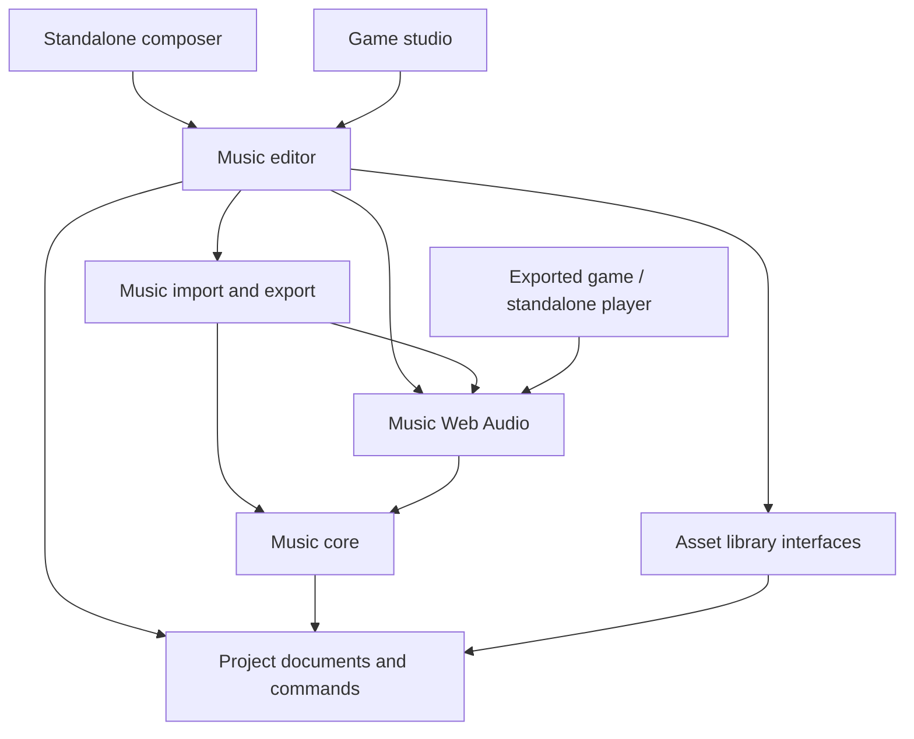

# Repository and reusable asset strategy

Decision: October 16, 2026. This extends the [framework plan](02-framework-plan.md). The repository scaffold exists; the products, APIs, library, and export features below are planned.

## 1. Recommendation

Use one personal GitHub monorepo, **`mstefanko/one-page-game-framework`**, with independent creative tools and shared document, playback, storage, and export packages. Start with the chiptune composer. It must be useful without creating a game, opening the full studio, or signing in.

Use public visibility, matching the existing [Terminator repository](https://github.com/mstefanko/terminator-game). Keep that game in its own repository. Keep this checkout independent of the containing general-purpose workspace: initialize Git inside `one-page-game-framework`, and publish only this directory.

“One page” describes an exported game. It does not constrain the editor, source tree, tool website, or personal asset collection to one file. A music tool can also export a self-contained player HTML file, but WAV and editable song downloads are equally important products.

| Option | Strength | Cost | Decision |
| --- | --- | --- | --- |
| One repo with explicit package boundaries | Atomic format/player/editor changes; shared fixtures; one issue tracker | Requires dependency checks and clear ownership | Adopt now |
| Separate repo for every tool | Independent ownership and release cadence | Early format drift, repeated infrastructure, cross-repo upgrades | Split only after stable interfaces and independent maintainers justify it |
| Everything inside the game studio | Fast first integration | Music tool becomes hard to reuse; game state leaks into assets | Reject |
| Embed/fork a complete external music editor | Mature editing workflow | Format, interface, and adaptation requirements inherit another product's choices | Keep as fallback if the composer proof is too expensive |

## 2. Boundaries and folder ownership

Use npm workspaces and TypeScript for implementation; React/Vite for editor applications, as already planned. Start without task orchestration infrastructure beyond npm. The scaffold has private package manifests and documentation, not fake implementation entry points or empty build scripts. `@onepage/*` names are internal workspace names; no npm namespace ownership or publication is implied.

| Location | Responsibility | Must not own |
| --- | --- | --- |
| `apps/composer` | Standalone application, onboarding, composition routes | A second score format, synth, or editor implementation |
| `apps/studio` | Full framework shell, game context and asset picker | Music editor internals |
| `packages/project` | TypeBox document definitions, generated schemas, validation/migrations | Browser UI, storage backends, audio nodes |
| `packages/music-core` | DOM-free score compilation, tick math, event ordering, cue decisions | React, AudioContext, filesystem, game simulation |
| `packages/music-web-audio` | Shared synth, audio-clock scheduler, real-time and offline graphs | UI, importers, account/library calls |
| `packages/music-editor` | Reusable React composer feature, commands, selection and accessibility | A hard dependency on either application shell |
| `packages/music-io` | MIDI/other import adapters, loss reports, WAV/MIDI/player exports | Game simulation or storage authority |
| `packages/asset-library` | Catalog, revisions, dependency closure, storage interfaces | Mandatory hosted service or editor-specific UI |
| `examples/music` | Original sample-song briefs now; validated songs/patches later | Film/game soundtrack copies or user libraries |
| `docs` | Authoritative decisions, design brief, implementation handoff | Undocumented production behavior |

Add `simulation`, `runtime`, `studio-server`, `exporter`, `cli`, and non-music editors when their first implementation slice begins. Their responsibilities remain as defined in the framework plan. Avoid dozens of unused package shells now.

Planned dependency direction (not installed dependencies yet):



Node services provide filesystem adapters; hosted apps provide browser adapters. Runtime bundles contain only selected data and playback dependencies. Enforce actual import boundaries in CI as soon as source code exists: runtime/core cannot import editors, React, Node built-ins, storage services, or MIDI parsers. Add separate runtime entry points with no top-level DOM access or synthesis on module import. A CLI may validate/compile music without an audio device; rendering WAV in the CLI will initially require a pinned headless-browser host, not a fictional Node AudioContext.

## 3. GitHub working model

- `main` is the integration branch. Use short `codex/<topic>` or other contributor branches and pull requests for subsequent work. This initial repository bootstrap is the first main commit.
- Keep code, format changes, validating fixtures, migrations, and documentation together. Require a schema version change for incompatible persisted data changes.
- Use a single tracker with `area:composer`, `area:foundation`, `area:library`, `type:design`, and `type:implementation` labels, plus milestone acceptance gates. Seed implementation issues from [the composer plan](04-chiptune-composer-plan.md).
- Bootstrap CI checks workspace metadata, current documentation links, and preservation of the archived source files. Add type checks, lint, unit/browser tests, import-boundary enforcement, and build-size checks when implementation exists. A green scaffold check is not proof of a working composer.
- Recommend required CI and blocked force-pushes on `main` after the bootstrap. Do not require another person's review in a single-maintainer repo. Branch rules are a separate setting; do not describe them as configured unless verified.
- Keep packages `private` until APIs stabilize. Use repository prerelease tags for integrated previews; introduce package publishing/version tooling only when a real external consumer needs it.
- Use MIT for new original framework code and documentation. Preserve upstream notices and historical-report attribution separately. Asset licenses/provenance are explicit per asset; the repository license does not transfer ownership of imported songs.

Do not commit user songs, imported MIDI source files, private library catalogs, browser cache, recordings, credentials, or build output by default. Approved original fixtures are the exception. Release downloads can carry built tools and original example packs. Large user libraries belong outside the source repo; GitHub is not the personal content database.

## 4. Hosting and release units

Publish future tools under paths such as `/one-page-game-framework/composer/` and `/one-page-game-framework/studio/`. Use relative assets and hash routes initially so refreshing a nested editor route does not require a server rewrite. Test the project-path prefix, not only `/`.

[GitHub Pages](https://docs.github.com/en/pages/getting-started-with-github-pages/what-is-github-pages) serves static sites; it does not supply accounts, database writes, or a cloud asset library. A Pages composer can still save to browser storage and download files. No live composer URL is promised by this scaffold. Enable Pages deployment only when a useful application build exists.

Individual game projects can use their own personal repositories and publish one HTML artifact, matching Terminator's distribution model. They pin a framework version and asset revisions. A later shared runtime package can be installed at build time; published games must not fetch their assets or playback engine at runtime.

Release units are deliberately distinct:

1. Tool website/build: normal multi-file static application.
2. Source project/asset pack: editable JSON, patches, media, provenance, and version lock.
3. Game artifact: one HTML with runtime/content and optional recovery data.
4. Music artifact: WAV, MIDI, editable pack, or standalone player HTML.

## 5. Storage: export and library, together

**Provide both.** Every creation can be downloaded immediately. Saving to a reusable library should be the normal convenient workflow, with no account requirement. Start with a personal library shared across tools and projects on the same machine. Multi-user/cloud sharing is a later adapter, not a prerequisite.

| Mode | Source of truth | What “saved” means |
| --- | --- | --- |
| Local studio / local composer server | User-selected project/library folders, ordinary JSON and assets | Atomic, revision-checked disk write completed |
| Hosted standalone composer | IndexedDB catalog/documents, optional OPFS blobs with capability checks | Saved on this browser/device, not synced or permanently backed up |
| Portable export | Downloaded source ZIP or asset pack | Explicit backup that works outside this app |
| Future account library | Service metadata + immutable object storage | Synced only after server acknowledgment; local pending state visible |

Use the same document commands in all modes. Preserve the framework's local-server workflow for agent/human editing. A browser download or uploaded folder is not continuing permission to edit the original disk folder. Request persistent browser storage when available, show whether it was granted, and retain download/restore paths; [persistence requests can be denied](https://developer.mozilla.org/en-US/docs/Web/API/StorageManager/persist).

A local library root might contain:

```text
library.json                    library identity and format version
assets/<asset-id>/metadata.json  name, kind, tags, provenance, preferred revision
assets/<asset-id>/revisions/<revision>/manifest.json
assets/<asset-id>/revisions/<revision>/source/...  immutable dependency closure
drafts/<draft-id>/...            working copy and base revision
cache/...                       rebuildable previews and search index
```

Do not commit this user content to the framework repo. Metadata/indexes can be rebuilt from manifests. Binary blobs may be content-addressed for deduplication; keep the storage optimization out of authored song references.

### Identity, revisions, and reuse

Separate a stable asset ID from its immutable revision hash and the editor's optimistic-concurrency revision. Hash canonical JSON plus dependency hashes with a documented algorithm; exclude display timestamps and transient selection. Each saved revision records asset kind, schema version, backend version, name, tags, author/source/license, dependencies, and optional `derivedFrom` provenance.

“Save” persists a recoverable working draft; “Save version” creates an immutable named/library revision. Automatically checkpoint drafts so a user need not understand Git to recover work. One undo history belongs to one working revision; an external reload resets or explicitly resolves it.

**Use in game** resolves the complete dependency closure, copies that revision into the game project, registers stable local IDs, and records origin asset/revision in `assets.lock.json` (proposed filename). No project contains an absolute path to a personal library. Offline build works after disconnecting or deleting the library.

Editing an in-project copy does not mutate its library source. “Save as new library version” is explicit. Updating a pinned library dependency displays the changes and compatibility diagnostics, then applies a revision-checked transaction. A fork gets a new asset ID with `derivedFrom`; a new version keeps identity. Colliding imported IDs with different content require fork/remap, never overwrite-by-name. Remap references throughout the closure.

Deletion uses trash/recovery first. Pinned project copies continue to work. Never garbage-collect revisions referenced by retained local drafts, versions, or packs. A future cloud service also needs retention rules for published references.

### Cross-tool contracts

The library understands asset kinds and dependencies; specialist tools own editing. A score references patches; a game cue references a score; a cutscene references a cue and transition policy; SFX stays a distinct asset kind. The asset picker shows audition/thumbnail, compatibility, attribution, revision and size. A common library is useful even when only the composer is implemented.

Add a small `AssetProvider` interface for list/search, read revision, save draft/version, resolve dependencies, and import/export packs. Do not build a marketplace abstraction. Desktop and browser sources implement the same interface but expose honest capabilities such as external file watching or no cross-device sync.

Later cloud work needs authentication, access control, private-by-default uploads, object storage, quota/billing decisions, conflict copies, and deletion/revocation semantics. A public link should identify an immutable published version. Never upload a user's library merely because they clicked local Save. Portable pack sharing delivers useful sharing before that service exists.

## 6. What this changes in the original plan

The composer gets a standalone delivery track before the full game studio. It shares schema, commands, synth and export contracts with the framework; it does not wait for collision, sprite, or renderer milestones. Keep the original game-runtime gates intact. The first cross-product acceptance is one library song used in a tiny exported game with two intensity levels.

The initial GitHub setup contains preserved research, these plans, the design prompt, private workspaces, contributor guidance, a lockfile, scaffold CI, and implementation tracking. It does not imply implemented music playback, exports, storage, cloud sync, or a deployed website.
