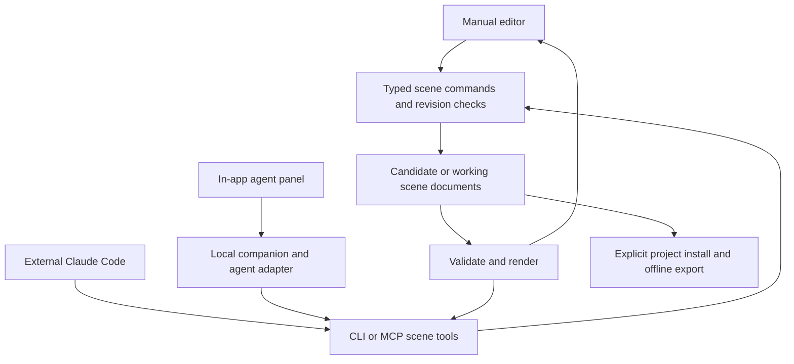

# Agent-assisted direction, layered sets and Claude connections

October 18, 2026. Proposed architecture and workflow, based on the supplied mockups and current primary-source research. Complements the [mockup review](22-director-mockup-review.md) and revises the authoring priorities in [the implementation plan](20-cutscene-director-implementation-plan.md). No Claude integration, credential change or asset-generation service was installed during this research.

**Consolidated follow-on:** these research findings are now incorporated into the [authoritative implementation plan](20-cutscene-director-implementation-plan.md), including appearance families, style/environment switching, incremental dependencies and the current R0–R8 delivery sequence. This document's A0–A5 table is retained as historical planning context, not a competing execution order. Use the [final design prompt](24-director-final-claude-design-prompt.md) for the next mockup round.

## 1. Product decision

Make **describe → assemble → play → direct revisions → keep → use in game** the primary workflow. Manual authoring remains complete and uses the same document commands. This changes the director from a tool that mostly edits a preassembled scene into a tool that gets the user to a useful first scene and lets them control its evolution.

Use a hybrid content strategy: reusable modular assets, reusable assembled sets, and agent-assisted assembly/new asset creation. A library and an agent solve different problems. The library makes results predictable and reusable; the agent finds, arranges and adapts them to a particular story.

Provide an in-app agent panel, with a local companion hosting project access and agent processes. Also expose the same scene operations to an externally running Claude Code through CLI/MCP. Keep the first release local; hosted orchestration adds accounts, remote project storage and billing work unrelated to proving the creative workflow.

“One page” still describes the exported game. It does not require the authoring app, local service or personal library to fit inside that HTML. The finished game carries no API key, agent process, prompt history or service dependency.

## 2. How non-sprite assets should work

### Three levels of reusable content

| Level | Examples | Typical use |
| --- | --- | --- |
| **Asset** | Building image, platform tile strip, lamp prop, glow mask, ambience recording | Smallest separately editable/reusable unit |
| **Set** | Night station assembled from architecture, platform, props, lights, markers and weather defaults | Best starting point for users and agents; supports different camera shots |
| **Shot recipe** | Arrival wide, two-person warning, doorway reveal, departure | Set/cast slots plus motion, camera, dialogue placement and timing |

A set is a reusable scene graph, not necessarily one flattened image. Shots reference the same set revision and add overrides. Change a set instance's rain or sign without changing every scene using that set. **Save as reusable set** promotes the result explicitly.

Support a simple background image too. A distant mountain that never moves independently can remain baked into a backdrop. Make a component independent when the user may move it, animate it, hide behind it, recolor it, illuminate it, or reuse it. Do not require every window to be a separate asset.

### The station example, bottom to top

| Render group | Contents | Editable behavior |
| --- | --- | --- |
| Distant background | Sky, skyline, far buildings | Palette/tint, position, slow parallax; may be a single image |
| Set architecture | Station facade, doors, windows, rear columns | Instances/groups, replacement, optional door animation |
| Ground | Platform, edge stripe, rails/puddle decals | Layout, walk markers, feet baseline; visual ground is not automatically collision geometry |
| Actor-depth objects | Keeper, courier, benches, luggage, some posts | Stable depth/Y-sort group, front/behind relationships |
| Foreground occluders | Roof edge, close pillars, railing | Explicit front pass, masks/cutouts; split an image when part must be behind actors and part in front |
| Lights and local effects | Lamp glow, lantern glow, emissive windows, subtle reflection | Position or socket attachment; color, radius, intensity, flicker seed; masks/depth prevent glowing through everything |
| Weather | Background rain, foreground rain, optional mist | Density, direction, speed, depth, bounds and exclusion masks |
| Screen presentation | Caption/bubble, title card, fade | Screen or actor-anchored layout; safe area and accessibility |

Light effects are stylized compositing recipes in the first renderer, not a promise of physically accurate lighting or automatic cast shadows. Rain is a parameterized deterministic effect rather than hundreds of individually authored droplets or a video loop. Add explicit ambient audio as a separate asset; weather visuals do not implicitly create sound.

The supplied mockup's `lc-stage.js` already separates some drawing functions, but `station()` still bakes the entire place together. Use that visual as a reference, then recreate the structural separation above. Do not turn arbitrary imported drawing functions into the general asset format.

### Set document contract

Extend the proposed document catalog with a typed `SetDocument`:

```text
id, schemaVersion, logicalBounds, pixelsPerUnit, styleProfileRef
nodes[]
  id, kind (image | tile-strip | group | prop | light | effect)
  assetRef + pinned revision, parentId, transform, renderGroup, depth
  kind-specific typed parameters, optional maskRef
markers[]: entry, exit, actor stand positions, camera targets
presentationGround: baseline/path region (explicitly not gameplay collision)
variants: day/night, wet/dry, optional props
requirements, dependencies, provenance
```

Use logical world coordinates and parent transforms. A lantern glow attaches to the hand/lantern socket and follows it; it is not hand-positioned anew in every shot. Camera framing determines the visible crop. Store mask coordinate spaces and resolve them explicitly. Validate parent cycles, missing masks, unknown effect implementations, depth ties and unsupported blend modes.

Effects must evaluate from absolute scene time and a seed. Reconstruct particle lifetimes from authored spawn intervals or a deterministic precomputed table; don't step from zero each time or consume random numbers in arbitrary draw order. This preserves direct seek and avoids preview/export discrepancies.

Expose a readable layer tree with lock/hide/solo, selection on stage, grouping, duplicate, move forward/backward and **Edit set**. Locking a layer to prevent agent edits is distinct from hiding it during editing; neither should accidentally remove it from export. A set instance can be “protected except weather,” enforced by writable property paths.

### Asset creation and sourcing order

1. Inspect this game's catalog and compatible personal-library assets.
2. Try a coherent set or style kit before mixing unrelated search results.
3. Assemble from existing props, tile strips, images and deterministic effect recipes.
4. Search approved external sources if needed, preserving the item URL, author/license, original file and selected revision.
5. Generate new raster art through an explicitly configured media tool, or create simple palette/vector geometry through a supported authoring adapter.
6. Import, normalize and validate the result before inserting it into a candidate scene.

Use a style profile: reference images, palette, pixel density, actor height, camera perspective, outline/shading rules, lighting direction and animation cadence. Check candidate assets against it. Similar tags do not guarantee a coherent set; show a small style/contact-sheet review before paying to generate every missing item.

For new raster sets, create a composition blockout first, then request a useful small number of layers with a shared coordinate system, empty actor space, overscan for camera moves and transparent foreground props. Inspect actual alpha, dimensions and edges. Generating layers separately can produce inconsistent perspective; supplying a common reference/layout and compositing review is necessary. Splitting a flattened generated picture into editable layers is a separate segmentation/inpainting task with imperfect results; do not advertise “ungroup image” as lossless.

Keep weather, glows, dialogue, moving doors and removable props out of the main backdrop whenever they need independent control. A high-quality flat backdrop is still acceptable for a simple shot; annotate its limitations instead of blocking progress.

A Claude connection is not itself proof of an image or voice generation capability. Model the director agent, image creation, speech creation, audio processing and asset search as separate discoverable services. If only Claude is connected, it can compose from existing assets and supported procedural recipes; an unavailable media service yields a placeholder or import task, not a claim of finished generated art.

## 3. What other applications demonstrate

The following is a comparison of documented workflows, not endorsement of their security implementations or a recommendation to fork them. Sources checked October 18, 2026.

| Product / source | Verified pattern | What to borrow |
| --- | --- | --- |
| [Pencil / pen.dev authentication](https://docs.pencil.dev/getting-started/authentication) | Agent settings offer existing Claude Code configuration, API-key and provider-specific connection paths; connection can be rechecked and a saved key cleared | One visible connection screen; identify which runtime owns authentication; don't ask users to reenter credentials unnecessarily. Its public page does not establish its internal key-at-rest storage implementation |
| [Pencil agent workflow](https://docs.pencil.dev/core-concepts/ai-agents) | Canvas selection and references become prompt context; conversation sessions, Stop, alternatives and usage are visible | Selection-aware direction, resume history, cancel, visual alternatives, honest cost indicators |
| [Pencil CLI](https://docs.pencil.dev/for-developers/pen-cli) | Uses the same editor engine headlessly, can connect to a running app, and exposes document operations/screenshots | CLI and GUI should operate on one canonical scene model, with a render tool for checking the result |
| [Zed external agents](https://zed.dev/docs/ai/external-agents) | Hosts external agents through ACP while the agent owns its process, authentication and billing | Distinguish “connect my agent” from “configure a model API”; the app can display activity without owning subscription credentials |
| [Zed API access](https://zed.dev/docs/ai/use-api-access) | Provider keys entered into Zed are stored in the system keychain, not its settings JSON; environment variables can override them | Store only a credential reference in preferences; show the effective connection source and avoid silent billing-route switches |
| [tldraw agent starter](https://tldraw.dev/starter-kits/agent) and [AI architecture](https://tldraw.dev/docs/ai) | Supports Anthropic and other providers; combines screenshots, structured canvas data, selection, recent actions and history; validated actions modify the canvas | Give the director structured scene data plus rendered evidence and domain commands, not only a screenshot or raw file access. Use as an architecture reference rather than assume its SDK license fits this project |

The distinctive pattern is an agent that can **inspect and operate the document**, not merely generate text in a sidebar. The most useful context for “make this darker” is the selected layer ID, its current parameters, the shot/time, a screenshot and the user's protected items.

## 4. Claude access: recommended routes

### Route A — existing Claude Code controls the director

Best first integration for this user's local workflow. Start the project/director service and connect a user-managed Claude Code session to a small scene tool interface. The user can say “build the station arrival” in Claude; the director displays the draft as it is assembled. Iteration can continue from Claude while the user reviews or manually tweaks the app.

Expose a CLI first and a thin MCP server over the same operations. Claude Code supports [MCP connections](https://code.claude.com/docs/en/mcp); this does not require the director to possess the model credential. The connection grants project/tool access, not access to unrelated folders. Show **External agent connected** and the active scope in the editor.

This route establishes the agent workflow before a custom chat host exists. It must still return structured change batches and render previews; “an agent edited arbitrary files” is not the complete integration contract.

### Route B — direct inside Pocket Director

Make this the intended everyday experience: type a brief in the app and watch it build. A local companion runs the agent and streams status/results to the browser. The browser cannot launch a native CLI by itself, so the companion is a required capability, not a hidden assumption.

Two explicit connection choices:

- **Use installed Claude Code:** invoke the user's unmodified CLI through its supported interface and own sign-in. Treat this as an external-agent integration. Validate the supported binary/version and native authentication route. Do not build a counterfeit Claude login or copy its tokens into our app.
- **Use an Anthropic API key:** a companion-hosted Agent SDK adapter, or a smaller Client SDK tool loop, uses the user's own key. The Agent SDK supplies sessions, tool handling and permissions; a Client SDK loop gives more implementation work and more explicit control. Prefer the Agent SDK for the first integrated prototype, with only necessary scene capabilities enabled.

Official docs distinguish [Agent SDK, Client SDK and CLI](https://code.claude.com/docs/en/agent-sdk/overview), and document [CLI structured output and programmatic runs](https://code.claude.com/docs/en/headless). Runtime selection belongs behind a small adapter so scene commands remain independent of Claude-specific APIs. ACP is a possible later adapter for hosting other agents; MCP is the tool-access interface. They serve different directions of communication and are not interchangeable.

### Authentication and billing nuance

Anthropic's current [legal/authentication guidance](https://code.claude.com/docs/en/legal-and-compliance) allows an end user to sign in to an unmodified Claude Code binary with their own credentials under stated conditions, while prohibiting an app from collecting/intermediating Claude.ai credentials or offering its own Claude.ai login. Its Agent SDK overview directs third-party products toward API authentication. Therefore offer native external-Claude-Code connection separately from the API-backed embedded agent.

A recent [Claude Help update](https://support.claude.com/en/articles/15036540-use-the-claude-agent-sdk-with-your-claude-plan) discusses subscription use and monthly API credits. Do not hardcode “always free,” “API always costs extra,” or eligibility rules in the UI. Show the detected provider/billing route and link to current account information; verify the final distribution/authentication path before release. This plan is an engineering recommendation, not a legal approval.

### Routes C and D — browser-only and hosted

**Browser-only:** retain full manual editing and portable export. Offer connection/setup instructions for the local companion. Do not require pasting a long-lived provider key into IndexedDB/localStorage or ship one in JavaScript. A pure static web app has no hidden server for protecting a key.

**Hosted agent later:** requires user accounts, authenticated backend, secret vault, per-user jobs/storage, quotas, remote media handling and privacy controls. Use explicit API-based provider integration. Local personal-project paths would need upload or a paired local connector. Do not add this service just to avoid the local companion in the first prototype.

## 5. Connection settings and saved state

Add **Settings → Agents & services** at the framework authoring-shell level, usable by the standalone director and later other editors. A connected agent is not a game asset.

| Setting/state | Storage / behavior |
| --- | --- |
| Claude Code connection | Local executable/config-profile reference and capability/version status; native agent owns sign-in and refresh |
| API-provider connection | Key in OS credential vault via companion; preferences store provider/model and secret reference. If secure persistence is unavailable, offer session-only use or an explicit environment variable |
| Media/search connections | Separate credential references and capability labels: image creation, voice, asset search, mouth analysis |
| Per-project authorization | Explicit selected root, allowed tools/network sources, asset budget, permitted data sharing; local application metadata outside published source |
| Scene creative brief/style | Versioned project source, exportable with editable pack if desired |
| Scene candidates, locks and changes | Project working history/recovery metadata, not provider transcript alone |
| Agent conversation/run IDs | Local run database; explicit session binding to project + scene + variant; excluded from published game |
| Current selection/open panels | Editor session preferences |

Claude Code's [authentication documentation](https://code.claude.com/docs/en/authentication#credential-management) describes its own platform-specific persistence: macOS Keychain normally, with documented file-based cases on other platforms/fallbacks. Leave those files to Claude Code. Disconnecting Pocket Director should revoke the local pairing and stop managed runs; it must not silently log the user out of Claude globally.

Settings should show **Connected / Needs sign-in / Local service unavailable / Restricted by organization / Quota reached**, with Test connection, Reconnect, Clear API key, and a clear credential source. Native sign-in UI is launched by the native runtime. A locally running agent still sends chosen context to its model provider; label **Runs on this computer · model requests sent to Anthropic**, rather than imply all processing stays offline.

Keep provider secrets out of prompts, logs, project JSON, packs and generated HTML. The local service uses loopback, explicit origins, a short-lived session token, root containment and constrained commands. Pair the local UI deliberately; arbitrary webpages should not be able to invoke its agent/file-writing endpoints.

## 6. The main creation and iteration workflow

### First draft

1. **Brief:** choose a game slot or standalone scene; describe story/actions/style, target duration, actors, dialogue and whether voice is required. Attach references. Default asset policy: reuse existing, then approved free/imported material; request paid generation only within a configured budget.
2. **Understand the project:** agent inspects the real asset catalog, animation capabilities, set scale, music cues, outcome rules and the current scene revision. A concise plan appears as editable shot cards and an asset-needs list. Ask only about material ambiguity; routine staging proceeds.
3. **Block out:** build a complete rough sequence using available art/placeholders, correct actor scale, paths, captions and timing. The user can play it before art production finishes. Mark missing media honestly.
4. **Assemble and source:** pick or build a layered set, bind characters, fill missing art/audio, map supported clips, and preserve source/license/provider metadata. Produce one coherent candidate first; multiple alternatives are an explicit option with bounded cost.
5. **Validate and render:** check schemas/dependencies/locks, framing, caption overflow, animation/sockets, timing and outcome rules. Render representative frames and a short playable preview using the actual runtime. The agent can inspect these and repair a bounded number of times; syntactically valid JSON is not visual approval.
6. **Review:** show the playable candidate, unresolved placeholders and a compact list of choices. The user keeps it, requests changes, or continues manually. A completed validated candidate becomes a normal editable draft, not an opaque generated object.

### Targeted iterations

Example: “Keep the cast, line and platform layout. Make the station more abandoned, halve the foreground rain, brighten the lantern, and add half a second before the keeper speaks.”

The request carries selected scene/shot IDs, time range, current base revision, explicitly locked properties and style brief. The agent changes permitted set props/effect parameters and dialogue timing; it does not regenerate characters or rewrite the line. It renders the affected span and reports changes in the same terms. The user can select a light directly and make the last adjustment manually.

**Preserve what works** is a first-class operation: protect actor appearance, dialogue, camera path, set geometry, or whole shots. Locks are validated by the command service. A prompt alone cannot guarantee preservation. If a request needs a locked property, show the conflict and a proposed alternative; do not silently unlock it.

### Variants, review and collaboration

Every run starts from an immutable scene revision and writes to a candidate workspace. Show progressive valid snapshots on that candidate; don't stream malformed partial JSON into the active game. The human can keep editing the main draft. On completion, compare base→candidate and base→current: apply independent changes together or show the conflicting objects. Never overwrite a manual actor move with an older agent result.

Keep revision and comparison operations domain-aware. “Use Set B with Camera A” may be valid, but accepting a motion while rejecting its required clip is not. Accept dependency-complete change groups and rerun validation. Keep accepted iterations as one undo transaction with a label such as “Less rain, brighter lantern, later line.”

Store alternative scene snapshots separately from agent chats. Claude's [session documentation](https://code.claude.com/docs/en/agent-sdk/sessions) supports resume/fork, but those branch conversation history, not scene files. Use explicit provider session IDs, never “most recent conversation” for a multi-scene app. If a session expires, reconstruct context from the brief, current scene and accepted decisions. Chat history is useful memory; the project is authoritative.

Cancel invalidates pending writes, stops scheduling tool calls, and retains the last validated candidate for inspection. Retry should reuse already acquired assets and successful steps rather than duplicate files or bill for the same media repeatedly. Provider errors must not discard the scene. Stop and Undo are separate actions. SDK [file checkpointing](https://code.claude.com/docs/en/agent-sdk/file-checkpointing) is not a replacement for application transactions over media, library revisions and installed game assignments.

### Permission and cost experience

Authorize a project root, normal draft-editing tools and a spending/network policy once. Do not interrupt for every layer, frame or caption. Show progress and an always-available Stop. Ask only when an action crosses that configured scope: new paid generation beyond budget, uploading an unapproved reference, altering protected assets or installing/publishing beyond the requested operation. **Keep candidate** is a creative choice; **Use in game** remains an explicit installation action.

Show cumulative run cost or provider-reported usage where available, labeled as an estimate when appropriate. Track media-generation charges separately from language-model usage. When a service cannot expose subscription remaining limits, say unavailable rather than guess. Set retry/turn/media-job limits to prevent an unbounded “improve it” loop.

## 7. Shared command architecture



The shared domain service should expose a small tool vocabulary, all proposed:

| Tool family | Purpose |
| --- | --- |
| `inspect_project`, `read_scene`, `read_selection` | Return IDs, revision, bindings, capabilities, scope and compact context |
| `search_assets`, `preview_asset`, `inspect_set` | Search actual catalog, verify candidate assets and dependencies |
| `create_candidate`, `apply_scene_commands` | Apply typed operations against expected revision and writable scope |
| `import_asset`, `request_media_job` | Acquire/normalize content through approved sources/providers with cost/provenance |
| `render_frames`, `preview_scene`, `validate_scene` | Let the agent see and test the actual result |
| `diff_candidate`, `propose_result` | Return coherent change groups, diagnostics and comparison previews |

Commands include add/move set node, bind actor, map semantic animation, insert motion, set dialogue, set camera, set effect parameter and link timings. A tool may accept a batch so the agent can assemble a shot efficiently. Reject references to nonexistent IDs, locked paths, cyclic timing links, unknown schemas or arbitrary executable code. Render/effect recipes come from versioned supported implementations. New custom code is a separate trusted extension task, not a field in imported scene JSON.

Use run IDs and idempotency keys for media acquisition and commands. The companion persists the run state machine: queued → inspecting → composing → sourcing → validating → ready / needs input / failed / cancelled. Store provider/session IDs, base/candidate revisions, dependency hashes, tool results, costs and a concise decision summary. Keep sensitive prompts/references out of public exports by default.

The initial MCP wrapper should remain thin. Give ordinary composition tools no generic shell access. External Claude Code may have broader tools of its own; if strict isolation is needed, run it in a scoped environment and direct its work to the candidate folder. A connection label alone is not enforcement.

## 8. Delivery sequence: change from the original plan

Preserve the pure evaluator/offline runtime gates, but bring typed commands, layered sets and agent operation forward. Do not finish an extensive manual timeline before testing whether an agent can create a usable scene.

| Slice | Deliverable | Acceptance |
| --- | --- | --- |
| A0 — Scene/set contract | Original station assembled from separate layers, motions, dialogue and voice references; style brief; commands and locks | Manual and scripted edits produce the same document; direct seek and offline player still agree |
| A1 — Agent through external tools | CLI + thin MCP adapter, candidate creation, catalog search and frame render | Existing Claude Code creates a three-shot draft from a brief without editing engine code; app opens and edits it |
| A2 — Review and iteration UI | Hybrid stage/storyboard, Direction/Inspect/Changes dock, compare, variants, keep/discard | User locks cast, asks for weather/camera revision, keeps a candidate and undoes it as one step |
| A3 — Integrated local agent | Connection settings, local supervisor, native-Claude-Code path and API-backed adapter as supported, status/cancel/resume | Restart app and resume correct scene; credentials stay out of project/export; failed run preserves work |
| A4 — Asset production pipeline | Set library, import normalization, selected external search/media adapters, style checks and provenance | Replace one missing background/prop without regenerating approved actors or timings; no remote runtime dependencies |
| A5 — Robust game install | Shared installation/lock/flow transaction and offline build/recovery | Agent-produced and manually edited scene installs into the selected slot and works with all services disconnected |

A0/A1 are narrow vertical slices of D1–D3 in the original plan. A2/A3 change D4/D5's emphasis. A5 retains D6's definition of completion. Do not consider “agent chat can write JSON” or “mockup looks plausible” a finished director.

Required extra tests: locked-property enforcement; unrelated manual edit during run; same-property conflict; cancellation and stale response rejection; repeated media-job idempotency; missing/expired provider connection; alternate variant isolation; transcript resume against correct revision; secret-free pack/HTML; caption and camera checks on actual renders; and successful fully manual creation with the agent disconnected.

## 9. Immediate design decisions

Adopt the hybrid interface described in [the mockup review](22-director-mockup-review.md). Make Direct the default with a small contextual prompt, not a blank chat page. Let agents handle assembly and repetitive asset work while the human remains able to inspect every object and timeline action.

Start with local Claude Code connection plus shared scene tools, then add the in-app host. Put settings in the authoring framework, not the game. Keep image/voice/search providers separate. Store the scene's intent and accepted results in the project; store credentials and run history separately. Reuse sets and recipes first, generate missing art deliberately, and always bring the result back into the same editable scene format.
